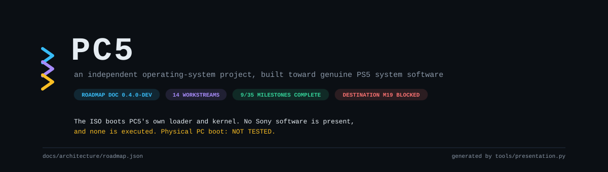

# PC5

**An independent engineering project that builds PC-side boot, hardware and
compatibility infrastructure toward running genuine Sony PlayStation 5 system
software on compatible PC hardware.**

PC5 is an independent engineering project whose destination is to run the
**genuine Sony PlayStation 5 system software** on compatible PC hardware. It is not a Linux
distribution with a PlayStation theme, not an imitation of the PS5 interface, and not
a project in which PS5 compatibility is an optional side quest.

**PC5 is not a Sony product and ships no Sony software.** The line above names the
platform this project is building and the destination it is built toward; nothing in this
repository contains or has executed Sony's system software.

| | |
|---|---|
| **Destination** | Genuine Sony PS5 system software executing on qualified x86-64 PC hardware (`M19`, level 5) |
| **Stage** | Boot substrate working under emulation and stub firmware; no physical machine yet |
| **Platform** | PC5 kernel and bootloader, freestanding, no Linux in the image |
| **Licence** | GPL-2.0-only, no vendored third-party code ([ADR-025](docs/TECHNICAL_DECISIONS.md)) |

**Navigate** · [About](#about-pc5) · [Completion](#overall-project-completion) · [Dashboard](#dashboard) · [Status](#status-at-a-glance) ·
[Architecture](#architecture) · [Evidence](#what-has-actually-been-demonstrated) ·
[Blockers](#what-is-blocked) · [Build](#quick-start) · [Docs](#documentation)

## Overall project completion


<!-- pc5:completion:begin -->
**26.7% of PC5's declared scope is complete and evidenced.** 9 of 35 milestones are `complete` (25.7% counted by milestone), 31 of 116 acceptance criteria are met, and the destination `M19` is **BLOCKED**.

| Measure | Value |
|---|---|
| **Overall completion** | **26.7%** — criteria-weighted |
| **Same figure by milestone count** | 25.7% (the two models agree within 1.0 points) |
| **Earned weight / total weight** | 31 / 116 |
| **Milestones complete** | 9 of 35 in 14 workstreams |
| **Current milestone** | `M2a`, `M2b`, `M9`, `M10` |
| **Remaining** | 16 not started, 6 blocked, 4 in progress |
| **By level of the hierarchy** | `L1` 74.1% · `L2` 50.0% · `L3` 0.0% · `L4` 0.0% · `L5` 0.0% · `L6` 0.0% — the low levels are the ones with evidence, the top levels have none yet |
| **Release-gating milestones** | 9 of 18 complete; outstanding: `M1`, `M2`, `M2a`, `M2b`, `M2c`, `M2d`, `M3`, `M7`, `M8` |
| **Partial credit** | excluded — no milestone declares `criteria_met`, so in-progress work counts 0 |
| **Hosted CI** | run `45879276706` **SUCCESS** at `a60c34f`, 1227 host tests OK (13 skipped) · the 13 skips are the hosted environment's own: artifact-gated tests whose build/ tree differs from a full local build |
| **Release readiness** | `M1b` **BLOCKED** — 2 acceptance criteria outstanding; nothing published (no tag exists on this history and the release job has never executed) |
| **Last verified** | 2026-11-23 — `verify` recorded **passed** at `86b862f` (10/11 committed gate records passed) |

One number, one formula, one source: `python3 tools/completion.py model` reprints this calculation from `docs/architecture/roadmap.json` and the records under `docs/evidence/validation/`, and `python3 tools/completion.py check` fails if a milestone id is duplicated, a weight is undefined, an in-progress fraction is invented, or a percentage is typed into prose instead of generated here.
<!-- pc5:completion:end -->

**How the number is made, and why it can be argued with.** The ring is
criteria-weighted, not commit-weighted: a milestone's weight is the count of acceptance
criteria the roadmap itself declares for it, and a milestone earns its weight only when
its state is `complete`, which in `docs/architecture/roadmap.json` means the criteria are
met and evidence is filed in the repository. There is no separate weight table to
maintain and no weight a reviewer can quietly renumber, because the weights are read
from the milestones. Counting milestones instead of criteria gives a different formula
for the same claim, and the two figures are printed side by side so a reader can see that
the number is not an artefact of the weighting choice.

Three refusals are the point of the design:

- **No partial credit without a record.** An `in_progress` milestone scores zero here,
  because nothing in the repository states which of its criteria are satisfied. The
  model will credit a fraction the day a milestone declares `criteria_met`, and it will
  not guess one tonight.
- **No promotion from adjacent facts.** A merge is not a verification, a green pipeline
  is not a completed milestone, and a *ready* release is not a *published* one. The
  dashboard keeps the build, the hosted run, the milestone graph and the release state on
  separate rows for exactly that reason.
- **No hand-typed statistics.** Every figure and percentage on this page is generated by
  `tools/presentation.py` from `tools/completion.py`; a number typed into the prose fails
  `make presentation-check`, which `make check` runs, so a stale claim is a red build
  rather than a permanent one.

The level-by-level bars are there because one percentage hides the shape of the project.
The measured completion is uneven by a wide margin: the two lowest levels of the hierarchy
are the only ones with credit, and levels three to six have none at all.  The honest
reading of the figure is that the foundation is being built outward from the hardware, not
upward from a demo — which is also why a headline number this low is the correct thing to
publish, and why the figure sits at the top of this page instead of in a badge.

## Read this first

**The genuine PS5 system software does not run on PC5 today.** It has never been
loaded here, and it has not been read either: the package in the repository root is a
Git LFS pointer, not the payload it declares, and no analysis of its bytes exists. What
exists is the substrate the destination needs, plus a per-stage account of how far it
has got — including the stages that are blocked with the blocker named.

The three things that are often confused, kept apart:

| Thing | State |
|---|---|
| The Sony PUP input (`PS5UPDATE.PUP`) | Git LFS pointer; payload **absent**; package type and version **unverified** |
| The PC5 bootable ISO (`build/pc5.iso`) | Built and structurally **verified**; boots PC5's own loader and kernel |
| Genuine Sony system-software execution | **BLOCKED** — no lawful route has been established yet, and nothing has been executed |

A PUP inside an ISO, a rename, a PC5 kernel boot or a PS5-shaped screen does not
establish the third row. [`docs/PS5_SYSTEM_SOFTWARE_TARGET.md`](docs/PS5_SYSTEM_SOFTWARE_TARGET.md)
explains what running the system software would require.

**Which operating system is whose.** This distinction is the project, so it is
stated rather than left to inference:

| Role | What it is |
|---|---|
| **The operating system** | The genuine Sony PS5 system software — its kernel, services, shell, setup and first-boot experience. That is the destination, and PC5 substitutes nothing for it. |
| **PC5** | The PC-side boot, hardware and compatibility infrastructure: loader, kernel, drivers, device models and platform contract. It exists to run the software above. |
| **PC5's own screens** | A diagnostic and recovery environment, clearly labelled as PC5. Supporting tooling for engineers — never presented as the PS5 system software or its interface. |

PC5-authored payloads, device models and conformance fixtures are engineering
test scaffolding. A PC5 kernel boot is evidence about PC5, never evidence that
Sony's software executed. [`docs/BRAND.md`](docs/BRAND.md) governs the PC5 marks
and forbids placing them on anything that depicts Sony's software.

## About PC5

PC5 builds the PC-side substrate a foreign operating system needs before it can run on
hardware that was not made for it: firmware handoff, exception delivery, memory
ownership, interrupt routing, device control, and the platform contract that ties them
together. It is aimed at one destination, stated in [`docs/ABOUT.md`](docs/ABOUT.md) in
the project's own words, and every step of it is backed by a record in this repository
rather than by an adjective. That page is the long form — identity, architecture, what
actually works, the standards a claim has to meet, the licence, and how to take part;
this README keeps the numbers and points at it.

| Read this next | Where |
|---|---|
| The full orientation, with the evidence behind each claim | [`docs/ABOUT.md`](docs/ABOUT.md) |
| How the system is put together | [`docs/ARCHITECTURE.md`](docs/ARCHITECTURE.md), specification in [`PC5_ARCHITECTURE_SPEC_v2.md`](docs/architecture/PC5_ARCHITECTURE_SPEC_v2.md) |
| Where the work is going, milestone by milestone | [`docs/ROADMAP.md`](docs/ROADMAP.md), data in [`docs/architecture/roadmap.json`](docs/architecture/roadmap.json) |
| How to build, verify and boot it | [`docs/BUILDING.md`](docs/BUILDING.md), [`docs/INSTALLATION.md`](docs/INSTALLATION.md) |
| What each gate proves, and what it does not | [`docs/TESTING_STRATEGY.md`](docs/TESTING_STRATEGY.md), [`docs/GATES.md`](docs/GATES.md) |
| The licence, and the no-vendoring rule | [`LICENSE`](LICENSE) (GPL-2.0-only), [ADR-025](docs/TECHNICAL_DECISIONS.md) |
| How to contribute, and the rules a change has to keep | [`CONTRIBUTING.md`](CONTRIBUTING.md), [issue templates](.github/ISSUE_TEMPLATE) |

**Status, stated once.** The completion figure above is generated from the milestone
graph and the committed verification records by [`tools/completion.py`](tools/completion.py).
[`docs/ABOUT.md`](docs/ABOUT.md) prints the same model rather than a copy of it, so the
two pages cannot disagree, and `make presentation-check` fails if either one drifts from
the data.

## Dashboard


<!-- pc5:stats:begin -->
| | |
|---|---|
| Product version | `0.2.0` (single source: `Makefile VERSION`) |
| Roadmap document | `0.4.0-dev`, updated 2026-11-22 |
| Milestones | 35 in 14 workstreams |
| Complete | 9 |
| In progress | 4 |
| Blocked | 6 |
| Not started | 16 |
| Destination | `M19` — Genuine system software boots on PC5 (DESTINATION) |
| Destination state | **BLOCKED** |
| Last recorded ISO verification | passed @ 86b862f |
| Last recorded test run | passed 1152/1152 @ 86b862f |
| Physical boot evidence | **none filed** |
| Genuine Sony software execution | **BLOCKED — nothing executed** |

Every cell is generated from `docs/architecture/roadmap.json` and `docs/evidence/validation/*.json` by `tools/presentation.py`; a statistic that is typed into the prose instead fails `make presentation-check`.
<!-- pc5:stats:end -->

The dashboard is not maintained by hand. `tools/presentation.py` rebuilds it from
`docs/architecture/roadmap.json` and the committed records under
`docs/evidence/validation/`; `make presentation-check` fails if a card, a count or a
commit stamp no longer matches those sources.

## Status at a glance

Every label below is generated from the milestone graph by `tools/presentation.py`
and checked by `make presentation-check`, which `make check` runs; nothing in the table
is typed by hand. A `complete` milestone renders as **VERIFIED** because it carries
evidence in the repository, and a physical claim needs a filed record under
`docs/evidence/`.

<!-- pc5:status:begin -->
| Capability | State | Where it is recorded |
|---|---|---|
| ISO build and structural verification | **VERIFIED** | `M1a` `M1h` |
| BIOS boot path (legacy firmware) | **VERIFIED** | `M1a` |
| UEFI boot path | **VERIFIED** | `M1c` |
| Emulated PC boot harness (v86) | **VERIFIED** | `docs/TEST_RESULTS.md` |
| Real OVMF firmware gate on this machine | **NOT TESTED** | `docs/TEST_RESULTS.md` |
| Physical PC boot | **NOT TESTED** | no record filed — `docs/evidence/` |
| Hardware drivers for the qualified list | **NOT STARTED** | `M2` |
| Platform services (processes, syscalls) | **NOT STARTED** | `M3` |
| PS5 platform contract | **IN PROGRESS** | `M10` |
| PS5 platform device models | **NOT STARTED** | `M11` `M12` `M13` `M14` `M15` `M16` |
| Security and authenticity boundary | **BLOCKED** | `M17` |
| Genuine Sony system-software load | **BLOCKED** | `M18` |
| Genuine Sony system software executing | **BLOCKED** | `M19` |

States are generated from `docs/architecture/roadmap.json` by `tools/presentation.py` — `complete` renders as **VERIFIED** only when the milestone carries its evidence, and a physical claim needs a filed record under `docs/evidence/`. Nothing in this table is typed by hand.
<!-- pc5:status:end -->

How to read it: **VERIFIED** means the evidence exists in this repository, at the
level named in [`docs/TESTING_STRATEGY.md`](docs/TESTING_STRATEGY.md) — an emulator
pass is not a machine. **NOT TESTED** means the code may exist but has never run on
the hardware it targets. **BLOCKED** means a named dependency cannot be satisfied
here, not that work was abandoned.

## Architecture


One platform, fourteen workstreams (`WS0`–`WS13`), no second product and no side
track. The destination workstream is **WS10 — PS5 platform compatibility**: a model of
the PS5 platform (CPU and privilege model, unified memory, storage, graphics, audio,
USB, service devices, security state) on top of which genuine system software can
execute.

* The **destination is on the critical path**: `python3 tools/roadmap.py path` prints
  the longest dependency chain, and it ends at `M19`.
* **Linux** is an optional hardware-enablement substrate, never the product
  (ADR-020). The build passes every gate without it.
* **Level 5 cannot be claimed by a lookalike.** `product.destination.must_not_be_satisfied_by`
  lists what does not count: a PC5 kernel booting, a model running PC5 payloads, an
  imitation of the interface, an emulator menu PC5 drew.

Authority: [`docs/architecture/PC5_ARCHITECTURE_SPEC_v2.md`](docs/architecture/PC5_ARCHITECTURE_SPEC_v2.md)
· graph: [`docs/architecture/PC5_MILESTONE_GRAPH.md`](docs/architecture/PC5_MILESTONE_GRAPH.md)
· measured audit: [`docs/architecture/ARCHITECTURE_DISCREPANCY_REPORT.md`](docs/architecture/ARCHITECTURE_DISCREPANCY_REPORT.md).

## Progress


**How the bars are computed:** each bar is the count of milestones in that
workstream by state, as recorded in `roadmap.json`. A bar is not a measure of effort,
difficulty or time, and it is certainly not a compatibility percentage — it is a count
of graph nodes. A milestone is `complete` only when its acceptance criteria have
evidence, `blocked` only when a named dependency cannot be met, and a blocked milestone
is not partial progress.

## From commit to boot


Steps three and four are the ones that need a machine. The procedure, the record format
and the validator for that first physical boot already exist —
[`docs/hardware/M1_PHYSICAL_BOOT_PROCEDURE.md`](docs/hardware/M1_PHYSICAL_BOOT_PROCEDURE.md)
— so the first person with hardware produces evidence that can be checked rather than
a screenshot. See also [`docs/INSTALLATION.md`](docs/INSTALLATION.md).

> A `PS5UPDATE.PUP` written into an ISO does not make it a bootable PS5 system. PC5
> does not do that, and does not claim it could.

## What has actually been demonstrated


<!-- pc5:evidence:begin -->
| Evidence | Gate | Result | Recorded at | Date |
|---|---|---|---|---|
| Host and kernel tests | `make check` | **passed**, 1152/1152 | `86b862f` | 2026-11-23 |
| ISO structure and manifest | `make verify` | **passed** | `86b862f` | 2026-11-23 |
| Emulator execution (v86) | `make boot-test` | **skipped** | `86b862f` | 2026-11-23 |
| Stub firmware (unicorn) | `make stubtest` | **passed**, 58/58 | `86b862f` | 2026-11-23 |
| Real OVMF firmware | `make ovmf-test` | **passed** | `86b862f` | 2026-11-23 |
| Physical PC boot (UEFI/BIOS) | `tools/hw_record.py` | **NOT TESTED** — no record filed | — | — |
| Genuine Sony system software | — | **BLOCKED** — not present, not executed | — | — |

A record is a snapshot of one run at one commit. A run recorded against an earlier commit is not evidence for the current one, and no gate here is promoted by the existence of another gate's record.
<!-- pc5:evidence:end -->

The ladder is the point: each rung is proven by its own gate and none is inferred from
another. A passing host suite says nothing about hardware; an emulator boot says nothing
about real firmware; a stub-firmware pass is not an OVMF boot; an OVMF boot is not a PC.

## What is blocked

<!-- pc5:blockers:begin -->
| Milestone | What is blocked | Why |
|---|---|---|
| `M1b` | Automated CI and release publication | the pipeline is now active (installed as .github/workflows/build.yml on 2026-11-24, workflow 428605735); M1b still owes its two acceptance criteria: a tag that publishes pc5.iso, pc5.iso.sha256 and build-info.json, an… |
| `M17` | Security and authenticity boundary | no lawful trust path is known: the console's boot chain is anchored in Sony-specific silicon and fuses, and PC5 implements no circumvention (ADR-007, ADR-022). Until a lawful path exists this milestone can proceed onl… |
| `M18` | Genuine system-software load | requires a lawful, authenticated input (the M9 payload is absent from the tree) and the trust analysis of M17; PC5 will not decrypt or circumvent |
| `M19` | Genuine system software boots on PC5 (DESTINATION) | blocked on M17 (authenticity boundary) and M18 (lawful input); no evidence of any kind exists yet |
| `M20` | Genuine system-software runtime: services, shell and platform experience | blocked on M19 |
| `M21` | Genuine installation and reinstallation of the system software via PC5 | blocked on M17 and M18; the installation process has not been observed on PC5 and is not claimed |

A blocker is a dependency that cannot be satisfied here — a machine, a workflow permission, or a lawful path to Sony's authentication. None of them is work in progress.
<!-- pc5:blockers:end -->

## Quick start

Needs `gcc`, `binutils`, `make`, `python3` — nothing else. Two suites inside
`make check` drive the loader against an emulated firmware and need one pinned Python
module, `unicorn==2.1.4`, listed in [`requirements-harness.txt`](requirements-harness.txt).
Without it those tests **skip and say why**, and `make check` still reports
`Ran 924 … OK (skipped=109)` — the same count, so a machine without the module cannot
mistake a skipped suite for a passed one. With it they run: `OK (skipped=2)`.
The install is a venv, because a distribution Python managed under PEP 668 refuses
`pip install` outright, and because CI uses exactly this venv:

```sh
python3 -m venv .venv
.venv/bin/pip install -r requirements-harness.txt
export PATH="$PWD/.venv/bin:$PATH"    # so `make check` runs the venv's python3
```

```sh
make              # build/pc5.iso + sha256 + build/build-info.json
make verify       # structure, boot entries, ESP, hybrid MBR, plus the image manifest
make check        # host unit tests, kernel unit tests, contract, docs and generated files
make roadmap      # validate the milestone graph, release isolation, destination path
make boot-test    # boot the ISO in the emulator and assert the interface
make docs-check   # every Markdown link, heading anchor and documented command resolves
make citation-refs   # fetch the pull-request refs, for when evidence cites a commit that lives only on an open PR head
make presentation # regenerate the figures and every generated README block
make presentation-check  # read-only: are the generated files still current?
```

| Command | What it actually proves |
|---|---|
| `make` | the image builds reproducibly from the tree at this commit |
| `make verify` | the image is a valid ISO9660/El Torito medium, its contents match a manifest a second reader reproduces, and the ESP and hybrid MBR are well formed |
| `make check` | the host and kernel suites pass; the contract, documentation and generated-file guards hold |
| `make roadmap` | the graph is consistent and the destination is still reachable |
| `make boot-test` | PC5's own code boots under the v86 emulator and prints the expected interface |
| `make docs-check` | no document links a missing file, a renamed heading or a removed target |
| `make citation-refs` | the objects behind the evidence citations are present in this clone. A full clone of `main` resolves all 258 of them without this step; a tree that cites an open pull-request head, or one fetched with a history filter, cannot — and says so instead of implying the evidence is dead |
| `make presentation` | rewrites the figures and the generated README blocks from the data |
| `make presentation-check` | those files are current; part of `make check`, and it never writes |

Two optional gates need extra dependencies:

```sh
pip install "unicorn==2.1.4"
make stubtest     # the real BOOTX64.EFI against a stub firmware (not OVMF)
make ovmf-test    # real OVMF boot: 0 = verified, 1 = failed, 3 = not tested here
```

`make ovmf-test` reports **NOT TESTED** on a machine without QEMU/OVMF, and that is what
it reports here. Pinned builds use `SOURCE_DATE_EPOCH=1763251200`; see
[`docs/BUILDING.md`](docs/BUILDING.md).

Recording the evidence a run actually produced — the command, its exit code, the commit
and the date — is a separate, explicit act:

```sh
python3 tools/validation.py run check verify boot-test stubtest ovmf-test
python3 tools/validation.py list
```

## Writing the image to a USB device

`python3 tools/pc5ctl.py usb` is a **host-side** tool: it writes `build/pc5.iso` to a
block device so a machine can boot from it. It is not a PC5 kernel feature — the
kernel has no USB driver yet (`docs/KNOWN_LIMITATIONS.md`), which is why the tool runs
on the machine you are writing **from**, before any boot.

```sh
python3 tools/pc5ctl.py usb --iso build/pc5.iso --device /dev/sdX
# reads the image, re-verifies build/pc5.iso.sha256, prints the target and the
# topology findings, and stops here. Re-run with --yes only after checking the path:
python3 tools/pc5ctl.py usb --iso build/pc5.iso --device /dev/sdX --yes
```

**The boundary it enforces.** The target is compared against the storage that the
running system is actually built on — not against a name the operator typed:

| Rule | What happens |
|---|---|
| The device backing `/` | refused, by major:minor, whichever way the root is expressed (whole disk, partition, `/dev/root` alias) |
| The whole disk carrying the root filesystem | refused |
| Any **sibling partition** on that disk (e.g. `/dev/sda2` when `/` is on `/dev/sda1`) | refused |
| **dm / md / LVM** relationships — the root's slaves and holders, transitively | refused for every device in that closure, so a member disk of the same RAID or the physical volume under a logical volume cannot be picked out as "unrelated" |
| Checksum mismatch against the `.sha256` sidecar | refused before anything is opened |
| No `--yes` | exits 2, nothing written; `--yes` never overrides a safety refusal |

**Descriptor-bound identity.** A pathname is not an object: between a check and a write
the name can be unlinked, re-pointed at another device node, or replaced by a symlink.
So once the target is open, `pc5ctl` keeps that descriptor, asks the kernel what it
holds (`fstat` → `major:minor`), evaluates the whole protection decision against
**that identity**, and hands the **same descriptor** to `dd` — passed explicitly to the
child (`pass_fds`) and addressed as `/proc/self/fd/N`, so the write cannot be redirected
by a name. The name is consulted only to *refuse*: if it no longer resolves to the
object being held, the write stops. Every failure path — open failure, a descriptor that
cannot carry a write, an unreadable `/proc`, a `fstat` error, an identity that changed,
a child that cannot be launched — is a refusal with `nothing was written` and a non-zero
exit. There is no fallback to the pathname, because falling back is how a validated
descriptor becomes an unvalidated name.

**Unknown is not safe, and unreadable is not absent.** If a sysfs relationship cannot be
read, if a partition entry appears and then vanishes mid-enumeration, if the root
device has no sysfs entry, or if `/` turns out to be tmpfs/overlay/network with no single
backing device, the answer is **refuse** — a partial list of protected devices is
indistinguishable from a complete one at the point of decision, and that is exactly how
a disk belonging to the running system gets erased.

**What this cannot do.** No userspace code can make the topology atomic. `major:minor`
says what the kernel reports *now*: a device-mapper table reload, an md add/remove, a
partition-table rewrite, a root remount, or a replug that reuses a device number can all
change what the same identity means **after** the last check. The decision is recomputed
immediately before the child is launched, which shortens that window to microseconds
without closing it. The operational consequence: do not write an image from a system
whose own storage could be rearranged underneath you. See
[`docs/engineering/USB-IDENTITY-BOUNDARY-DESIGN-v1.md`](docs/engineering/USB-IDENTITY-BOUNDARY-DESIGN-v1.md).

**Automated tests, and their actual scope.** 95 tests in
`tests/test_pc5ctl_usb_safety.py` (56), `tests/test_pc5ctl_usb_descriptor_identity.py`
(27), `tests/test_pc5ctl_usb_cli_boundaries.py` (8) and
`tests/test_pc5ctl_usb_topology_unknown.py` (4): the topology rules, the descriptor
boundary, the child-inheritance contract, and a real `/bin/dd` writing through a real
inherited descriptor into a temporary **regular file**. The last file exists because a
review found that two unreadable-topology cases refused for a *second* reason as well, so
they could not localise the decision to the function that reads the relationship; its
control case pins that the fixture is otherwise complete. Three mutation harnesses prove the tests have teeth:
`evidence/usb-descriptor-remediation-v1/mutation_harness.py` (the nine reviewed mutants),
`evidence/usb-descriptor-remediation-v2/mutation_harness_v2.py` (the same nine mutation
texts, imported from the first, with an intention map that is measured and that fails if a
named test stops discriminating), and `evidence/identity-boundary-v1/usb_identity_mutations.py`
(the prior pass's eight). Restoring pathname-based validation, omitting `pass_fds`,
inheriting the wrong descriptor, skipping the identity re-read, accepting a partial
enumeration or reading an unreadable relationship as "empty" each fail a named assertion.

These tests are **synthetic by design** — temporary files, a synthetic `/sys/dev/block`
tree, and no device node is ever created or written. They establish that the guard's
decisions and call sequence are what the code claims. They do **not** establish
physical-device safety: no real disk, USB stick, firmware or machine has been used,
`mknod` is not permitted here, and no `udisks`/`systemd-repart` interaction has been
observed. **Writing media with this tool is therefore not deployment-approved: it
remains blocked pending physical-device validation and explicit authorisation.**

## Hardware and compatibility

PC5 targets ordinary x86-64 machines that would otherwise run Windows, booted
directly through firmware. It does not claim universal support, and no compatibility
percentage is published because the denominator would be invented.

| Environment | State | Notes |
|---|---|---|
| Emulated x86 PC (v86, SeaBIOS) | **verified** | CD-ROM, and the hybrid MBR with the CD detached |
| Real UEFI/OVMF firmware | **verified in a prior run** on the machine that had OVMF; **not re-run** here | see §16 of the test results |
| Stub firmware (unicorn) | **verified** | executes the real `BOOTX64.EFI` |
| Physical PC via UEFI | **not tested** | no machine available; procedure and record format are ready |
| Physical PC via BIOS/CSM | **not tested** | same |
| Secure Boot with enforced policy | **unsupported** | PC5 ships no signature and no key |

Drivers: ATA PIO with flush and read-back, ATAPI, ISO9660, FAT32 (read and write),
MBR/GPT discovery, PCI, ACPI, SMBIOS and PS/2 keyboard are implemented; APIC/SMP,
paging, NVMe, USB/HID, audio and the graphics stack are **not started**
(`M2a`–`M2d`, `M7`). Details and the qualification list:
[`docs/HARDWARE_COMPATIBILITY.md`](docs/HARDWARE_COMPATIBILITY.md) ·
[`docs/KNOWN_LIMITATIONS.md`](docs/KNOWN_LIMITATIONS.md) ·
[`docs/architecture/HARDWARE_STRATEGY.md`](docs/architecture/HARDWARE_STRATEGY.md).

## The PS5 package as an engineering input

<!-- pc5:pup:begin -->
| Property | Value |
|---|---|
| working-tree content | a Git LFS pointer (135 bytes, `sha256 6e8f5a459551…`) |
| declared object | `oid 42ea0e5aad13…`, size 1,423,697,408 B |
| payload in this checkout | **no** — only the pointer is tracked |
| analysed, decrypted or executed | **no**, in any sense |

Read from the tracked file on every generation, so the sizes cannot drift. Package type and version remain **UNVERIFIED**: a pointer is not an analysis.
<!-- pc5:pup:end -->

The package is a protected input (ADR-022): PC5 records hashes and structure, never
redistributes or modifies it, and implements no decryption, key handling or
authentication circumvention. What it would take to run the system software, and which
requirements are currently unsatisfiable, is classified in
[`docs/playstation/BOOT_FEASIBILITY.md`](docs/playstation/BOOT_FEASIBILITY.md).

## Documentation

**Getting started** — [`docs/BUILDING.md`](docs/BUILDING.md): toolchain, targets,
reproducibility · [`docs/INSTALLATION.md`](docs/INSTALLATION.md): writing media and
booting a machine · [`docs/RECOVERY.md`](docs/RECOVERY.md): the recovery console ·
[`docs/hardware/M1_PHYSICAL_BOOT_PROCEDURE.md`](docs/hardware/M1_PHYSICAL_BOOT_PROCEDURE.md):
the first physical boot, with the record format

**Architecture** — [`docs/architecture/PC5_ARCHITECTURE_SPEC_v2.md`](docs/architecture/PC5_ARCHITECTURE_SPEC_v2.md):
the authority · [`docs/ARCHITECTURE.md`](docs/ARCHITECTURE.md): what is implemented
today · [`docs/architecture/PC5_MILESTONE_GRAPH.md`](docs/architecture/PC5_MILESTONE_GRAPH.md):
the rendered graph · [`docs/architecture/PS5_PLATFORM_CONTRACT.md`](docs/architecture/PS5_PLATFORM_CONTRACT.md):
claims and interfaces · [`docs/architecture/LINUX_VS_FREESTANDING.md`](docs/architecture/LINUX_VS_FREESTANDING.md):
why the kernel is freestanding

**Roadmap and progress** — [`docs/ROADMAP.md`](docs/ROADMAP.md) ·
[`docs/architecture/roadmap.json`](docs/architecture/roadmap.json): the data everything
else is generated from · [`docs/architecture/ARCHITECTURE_DISCREPANCY_REPORT.md`](docs/architecture/ARCHITECTURE_DISCREPANCY_REPORT.md) ·
[`docs/architecture/RISK_REGISTER.md`](docs/architecture/RISK_REGISTER.md)

**Hardware** — [`docs/HARDWARE_COMPATIBILITY.md`](docs/HARDWARE_COMPATIBILITY.md) ·
[`docs/architecture/HARDWARE_STRATEGY.md`](docs/architecture/HARDWARE_STRATEGY.md) ·
[`docs/KNOWN_LIMITATIONS.md`](docs/KNOWN_LIMITATIONS.md) ·
[`docs/GAMING_COMPATIBILITY.md`](docs/GAMING_COMPATIBILITY.md)

**Testing and evidence** — [`docs/TESTING_STRATEGY.md`](docs/TESTING_STRATEGY.md): the
evidence levels and what each gate can prove · [`docs/TEST_RESULTS.md`](docs/TEST_RESULTS.md):
append-only results · [`docs/evidence/`](docs/evidence): physical-boot and validation
records · [`docs/PRESENTATION.md`](docs/PRESENTATION.md): how this page is generated

**PS5 platform research** — [`docs/original firmware ps5.md`](docs/original%20firmware%20ps5.md):
the original PS5 system firmware, identified by hash and size · [`docs/PS5_SYSTEM_SOFTWARE_TARGET.md`](docs/PS5_SYSTEM_SOFTWARE_TARGET.md) ·
[`docs/PS5_COMPATIBILITY_STATUS.md`](docs/PS5_COMPATIBILITY_STATUS.md) ·
[`docs/PS5_COMPATIBILITY_ARCHITECTURE.md`](docs/PS5_COMPATIBILITY_ARCHITECTURE.md) ·
[`docs/playstation/BOOT_FEASIBILITY.md`](docs/playstation/BOOT_FEASIBILITY.md) ·
[`docs/PS5_GAME_TEST_RESULTS.md`](docs/PS5_GAME_TEST_RESULTS.md)

**Security, legal and decisions** — [`docs/SECURITY.md`](docs/SECURITY.md) ·
[`docs/FIRMWARE_ANALYSIS.md`](docs/FIRMWARE_ANALYSIS.md) ·
[`docs/TECHNICAL_DECISIONS.md`](docs/TECHNICAL_DECISIONS.md) ·
[`docs/UPDATE_SYSTEM.md`](docs/UPDATE_SYSTEM.md)

**Brand** — [`docs/BRAND.md`](docs/BRAND.md): the PC5 logo, its monochrome and boot
variants, the colours and type it is drawn with, clear space, and the minimum
sizes · [`brand/`](brand): the generated SVG assets themselves, written by
`tools/brand.py` and checked by `make brand-check`

<p align="center">
  
</p>

**Contributing and audit** — [`CONTRIBUTING.md`](CONTRIBUTING.md), which also states
which document is authoritative for what ·
[`docs/PROJECT_AUDIT.md`](docs/PROJECT_AUDIT.md) · [`ci/README.md`](ci/README.md) · [`LICENSE`](LICENSE)

## Repository map

```
boot/     BIOS loader and UEFI BOOTX64.EFI
kernel/   freestanding kernel: storage, filesystems, PCI, ACPI, console
psm/      PS5 platform contract registry, claims and conformance doubles
tools/    build, verification, manifest, roadmap, validation, presentation, docs checks
tests/    host and kernel suites, emulator harness, documentation guards
docs/     architecture authority, roadmap, test results, evidence, procedure, assets
ci/       pipeline definition (stored here, not yet activated — see ci/README.md)
```

## Legal and independence

PC5 is an independent interoperability and preservation project. It is not affiliated
with, endorsed by, or authorised by Sony Interactive Entertainment. "PlayStation" and
"PS5" are trademarks of Sony Interactive Entertainment Inc.

PC5 contains no Sony firmware, keys or proprietary libraries, implements no
decryption or authentication circumvention, and will not redistribute them — see
[`docs/SECURITY.md`](docs/SECURITY.md) and ADR-022. It vendors no third-party source
archive and depends on no other project's code: prior art is cited in documentation,
never copied into the tree (ADR-025), and
`tests/test_project_independence.py` enforces it.

Licensed under the GNU General Public License version 2 only — [`LICENSE`](LICENSE).
