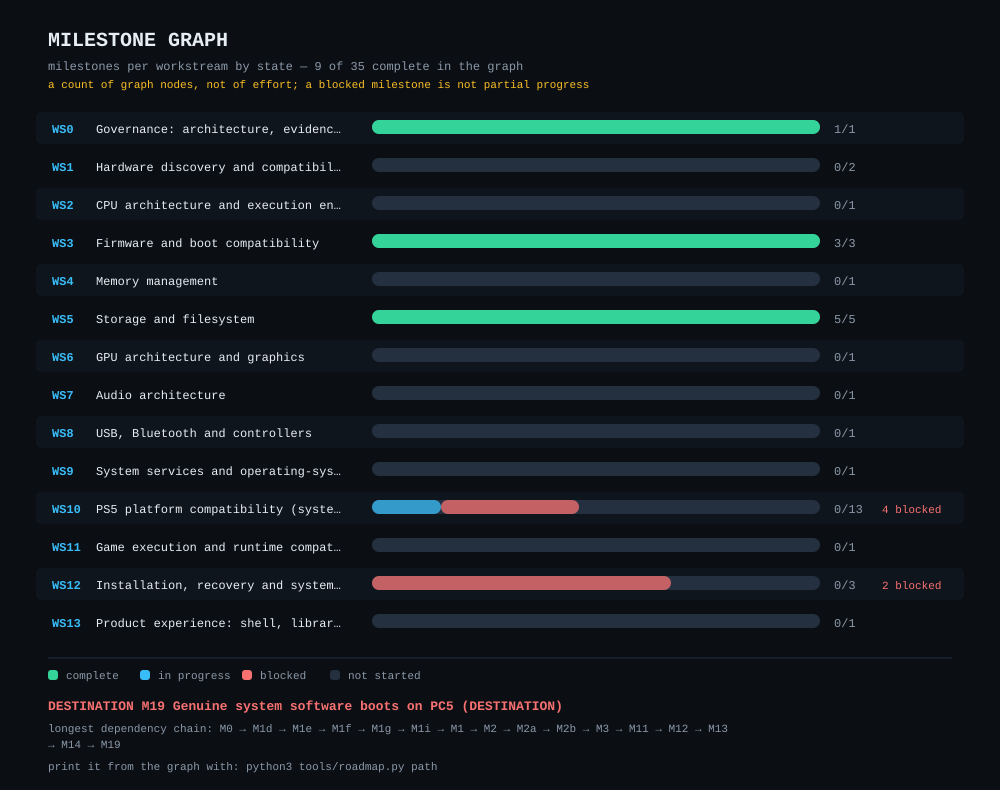
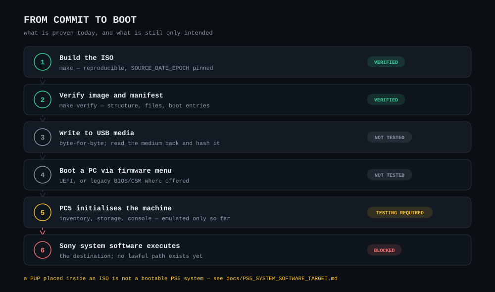

# PC5

**An independent operating-system project for PC hardware, built toward genuine Sony PlayStation 5 system software.**

PC5 is an independent engineering project whose destination is to run the
**genuine Sony PlayStation 5 system software** on compatible PC hardware. It is not a Linux
distribution with a PlayStation theme, not an imitation of the PS5 interface, and not
a project in which PS5 compatibility is an optional side quest.

**PC5 is not a Sony product and ships no Sony software.** The line above names the
platform this project is building and the destination it is built toward — it is not a
claim that Sony's operating system exists in this repository, and nothing here has
executed it.

The destination is defined as data — `product.identity` and `product.destination` in
[`docs/architecture/roadmap.json`](docs/architecture/roadmap.json) — and the test
suite fails if a document drifts away from it.

| | |
|---|---|
| **Destination** | Genuine Sony PS5 system software executing on qualified x86-64 PC hardware (`M19`, level 5) |
| **Stage** | Boot substrate working under emulation and stub firmware; no physical machine yet |
| **Platform** | PC5 kernel and bootloader, freestanding, no Linux in the image |
| **Licence** | GPL-2.0-only, no vendored third-party code ([ADR-025](docs/TECHNICAL_DECISIONS.md)) |

**Quick links** · [Status](#status-at-a-glance) · [Architecture](#architecture) ·
[Build](#quick-start) · [Compatibility](#hardware-and-compatibility) ·
[Documentation](#documentation) · [Legal](#legal-and-independence)

## Read this first

**The genuine PS5 system software does not run on PC5 today.** It has never been
loaded here, and it has not been read either: the package in the repository root is a
135-byte **Git LFS pointer**, not the declared 1.42 GB payload, and no analysis of its
bytes exists. What exists is the substrate the destination needs, plus a per-stage
account of how far it has got — including the stages that are blocked with the
blocker named.

The three things that are often confused, kept apart:

| Thing | State |
|---|---|
| The Sony PUP input (`PS5UPDATE.PUP`) | Git LFS pointer; payload **absent**; package type and version **unverified** |
| The PC5 bootable ISO (`build/pc5.iso`) | Built and structurally **verified**; boots PC5's own loader and kernel |
| Genuine Sony system-software execution | **BLOCKED** — no lawful path exists, and nothing has been executed |

A PUP inside an ISO, a rename, a PC5 kernel boot or a PS5-shaped screen does not
establish the third row. [`docs/PS5_SYSTEM_SOFTWARE_TARGET.md`](docs/PS5_SYSTEM_SOFTWARE_TARGET.md)
explains what running the system software would require.

## Status at a glance

Every label below is generated from the milestone graph by `tools/presentation.py`
and checked by `make presentation-check`, which `make check` runs; nothing in the table
is typed by hand. A
`complete` milestone renders as **VERIFIED** because it carries evidence in the
repository, and a physical claim needs a filed record under `docs/evidence/`.

<!-- pc5:status:begin -->
| Capability | State | Where it is recorded |
|---|---|---|
| ISO build and structural verification | **VERIFIED** | `M1a` `M1h` |
| BIOS boot path (legacy firmware) | **VERIFIED** | `M1a` |
| UEFI boot path | **VERIFIED** | `M1c` |
| Emulated PC boot harness (v86) | **VERIFIED** | `docs/TEST_RESULTS.md` |
| Real OVMF firmware gate on this machine | **NOT TESTED** | `docs/TEST_RESULTS.md` |
| Physical PC boot | **NOT TESTED** | no record filed — `docs/evidence/` |
| Hardware drivers for the qualified list | **NOT STARTED** | `M2` |
| Platform services (processes, syscalls) | **NOT STARTED** | `M3` |
| PS5 platform contract | **IN PROGRESS** | `M10` |
| PS5 platform device models | **NOT STARTED** | `M11` `M12` `M13` `M14` `M15` `M16` |
| Security and authenticity boundary | **BLOCKED** | `M17` |
| Genuine Sony system-software load | **BLOCKED** | `M18` |
| Genuine Sony system software executing | **BLOCKED** | `M19` |

States are generated from `docs/architecture/roadmap.json` by `tools/presentation.py` — `complete` renders as **VERIFIED** only when the milestone carries its evidence, and a physical claim needs a filed record under `docs/evidence/`. Nothing in this table is typed by hand.
<!-- pc5:status:end -->

How to read it: **VERIFIED** means the evidence exists in this repository, at the
level named in [`docs/TESTING_STRATEGY.md`](docs/TESTING_STRATEGY.md) — an emulator
pass is not a machine. **NOT TESTED** means the code may exist but has never run on
the hardware it targets. **BLOCKED** means a named dependency cannot be satisfied
here, not that work was abandoned.

## Architecture


One platform, fourteen workstreams (`WS0`–`WS13`), no second product and no side
track. The destination workstream is **WS10 — PS5 platform compatibility**: a model of
the PS5 platform (CPU and privilege model, unified memory, storage, graphics, audio,
USB, service devices, security state) on top of which genuine system software can
execute.

* The **destination is on the critical path**: `python3 tools/roadmap.py path` prints
  the longest dependency chain, and it ends at `M19`.
* **Linux** is an optional hardware-enablement substrate, never the product
  (ADR-020). The build passes every gate without it.
* **Level 5 cannot be claimed by a lookalike.** `product.destination.must_not_be_satisfied_by`
  lists what does not count: a PC5 kernel booting, a model running PC5 payloads, an
  imitation of the interface, an emulator menu PC5 drew.

Authority: [`docs/architecture/PC5_ARCHITECTURE_SPEC_v2.md`](docs/architecture/PC5_ARCHITECTURE_SPEC_v2.md)
· graph: [`docs/architecture/PC5_MILESTONE_GRAPH.md`](docs/architecture/PC5_MILESTONE_GRAPH.md)
· measured audit: [`docs/architecture/ARCHITECTURE_DISCREPANCY_REPORT.md`](docs/architecture/ARCHITECTURE_DISCREPANCY_REPORT.md).

## Progress



**How the bars are computed:** each bar is the count of milestones in that
workstream by state, as recorded in `roadmap.json`. A bar is not a measure of effort,
difficulty or time — it is a count of graph nodes. A milestone is `complete` only when
its acceptance criteria have evidence, `blocked` only when a named dependency cannot
be met, and a blocked milestone is not partial progress. Regenerate with
`make presentation`; `make presentation-check` fails if the figure and the data
disagree.

## From commit to boot



Steps 3 and 4 are the ones that need a machine. The procedure, the record format and
the validator for that first physical boot already exist —
[`docs/hardware/M1_PHYSICAL_BOOT_PROCEDURE.md`](docs/hardware/M1_PHYSICAL_BOOT_PROCEDURE.md)
— so the first person with hardware produces evidence that can be checked rather than
a screenshot. See also [`docs/INSTALLATION.md`](docs/INSTALLATION.md).

> A `PS5UPDATE.PUP` written into an ISO does not make it a bootable PS5 system. PC5
> does not do that, and does not claim it could.

## What the boot environment gives you

* a hardware inventory taken from firmware tables and CPUID, not from a database;
* its own storage stack: ATAPI PIO driver and ISO9660 reader, used at boot to mount the
  medium and read the kernel file back as a self-test;
* FAT32 read/write with independent read-back, MBR/GPT discovery, an ATA write path
  that is only ever used on explicit request;
* a 13-stage compatibility chain with the evidence behind every stage;
* self-tests for graphics mode, font, serial port, PCI, ACPI, SMBIOS, ISO9660
  descriptors and boot-descriptor integrity;
* a serial console on COM1 at 115200 8N1: `status`, `chain`, `hw`, `fw`, `storage`,
  `part`, `ls`, `read`, `put`, `wtest`, `diag`, `log`, `screen`, `page`, `reboot`,
  `halt`.

## Quick start

Needs `gcc`, `binutils`, `make`, `python3` — nothing else.

```sh
make              # build/pc5.iso + sha256 + build/build-info.json
make verify       # structure, boot entries, ESP, hybrid MBR, plus the image manifest
make check        # host unit tests, kernel unit tests, platform contract, docs guards
make roadmap      # validate the milestone graph, release isolation, destination path
make boot-test    # boot the ISO in the emulator and assert the interface (119 checks)
make docs-check   # every Markdown link, heading anchor and documented command resolves
make presentation # regenerate the figures and the status table above
make presentation-check  # read-only: are the generated files still current?
```

| Command | What it actually proves |
|---|---|
| `make` | the image builds reproducibly from the tree at this commit |
| `make verify` | the image is a valid ISO9660/El Torito medium, its contents match a manifest a second reader reproduces, and the ESP and hybrid MBR are well formed |
| `make check` | the host and kernel test suites pass; the documentation guards hold |
| `make roadmap` | the graph is consistent and the destination is still reachable |
| `make boot-test` | PC5's own code boots under the v86 emulator and prints the expected interface |
| `make docs-check` | no document links a missing file, a renamed heading or a removed target |
| `make presentation` | rewrites the figures and the status table from `roadmap.json` |
| `make presentation-check` | those generated files are current; part of `make check`, and it never writes |

Two optional gates need extra dependencies:

```sh
pip install "unicorn==2.1.4"
make stubtest     # 58 checks: the real BOOTX64.EFI against a stub firmware (not OVMF)
make ovmf-test    # real OVMF boot: 0 = verified, 1 = failed, 3 = NOT TESTED
```

`make ovmf-test` reports **NOT TESTED** on a machine without QEMU/OVMF, and that is
what it reports here. Pinned builds use `SOURCE_DATE_EPOCH=1763251200`; see
[`docs/BUILDING.md`](docs/BUILDING.md).

## Hardware and compatibility

PC5 targets ordinary x86-64 machines that would otherwise run Windows, booted
directly through firmware. It does not claim universal support, and no compatibility
percentage is published because the denominator would be invented.

| Environment | State | Notes |
|---|---|---|
| Emulated x86 PC (v86, SeaBIOS) | **verified** | CD-ROM, and the hybrid MBR with the CD detached — 119 checks |
| Real UEFI/OVMF firmware | **verified in a prior run** on the machine that had OVMF; **not re-run** here | 40 checks, `PC5-OVMF-BOOT-OK`; §16 of the test results |
| Stub firmware (unicorn) | **verified** | executes the real `BOOTX64.EFI`, 58 checks |
| Physical PC via UEFI | **not tested** | no machine available; procedure and record format are ready |
| Physical PC via BIOS/CSM | **not tested** | same |
| Secure Boot with enforced policy | **unsupported** | PC5 ships no signature and no key |

Drivers: ATA PIO with flush and read-back, ATAPI, ISO9660, FAT32 (read and write),
MBR/GPT discovery, PCI, ACPI, SMBIOS and PS/2 keyboard are implemented; APIC/SMP,
paging, NVMe, USB/HID, audio and the graphics stack are **not started**
(`M2a`–`M2d`, `M7`). Details and the qualification list:
[`docs/HARDWARE_COMPATIBILITY.md`](docs/HARDWARE_COMPATIBILITY.md) ·
[`docs/KNOWN_LIMITATIONS.md`](docs/KNOWN_LIMITATIONS.md) ·
[`docs/architecture/HARDWARE_STRATEGY.md`](docs/architecture/HARDWARE_STRATEGY.md).

## The PS5 package as an engineering input

| Property | Value |
|---|---|
| working-tree content | a Git LFS pointer, 135 bytes (`sha256 6e8f5a45…e73b42`) |
| declared object | `oid 42ea0e5a…b063fb`, size **1,423,697,408 B** |
| payload in this checkout | **no** — `tools/firmware.py` reports `size 135 bytes, kind unidentified` |
| analysed, decrypted or executed | **no**, in any sense |

The package is a protected input (ADR-022): PC5 records hashes and structure, never
redistributes or modifies it, and implements no decryption, key handling or
authentication circumvention. What it would take to run the system software, and
which requirements are currently unsatisfiable, is classified in
[`docs/playstation/BOOT_FEASIBILITY.md`](docs/playstation/BOOT_FEASIBILITY.md).

## Documentation

**Getting started** — [`docs/BUILDING.md`](docs/BUILDING.md) ·
[`docs/INSTALLATION.md`](docs/INSTALLATION.md) ·
[`docs/RECOVERY.md`](docs/RECOVERY.md) ·
[`docs/hardware/M1_PHYSICAL_BOOT_PROCEDURE.md`](docs/hardware/M1_PHYSICAL_BOOT_PROCEDURE.md)

**Architecture** — [`docs/architecture/PC5_ARCHITECTURE_SPEC_v2.md`](docs/architecture/PC5_ARCHITECTURE_SPEC_v2.md) ·
[`docs/ARCHITECTURE.md`](docs/ARCHITECTURE.md) ·
[`docs/architecture/PC5_MILESTONE_GRAPH.md`](docs/architecture/PC5_MILESTONE_GRAPH.md) ·
[`docs/architecture/PS5_PLATFORM_CONTRACT.md`](docs/architecture/PS5_PLATFORM_CONTRACT.md) ·
[`docs/architecture/LINUX_VS_FREESTANDING.md`](docs/architecture/LINUX_VS_FREESTANDING.md)

**Roadmap and progress** — [`docs/ROADMAP.md`](docs/ROADMAP.md) ·
[`docs/architecture/roadmap.json`](docs/architecture/roadmap.json) ·
[`docs/architecture/ARCHITECTURE_DISCREPANCY_REPORT.md`](docs/architecture/ARCHITECTURE_DISCREPANCY_REPORT.md) ·
[`docs/architecture/RISK_REGISTER.md`](docs/architecture/RISK_REGISTER.md)

**Hardware** — [`docs/HARDWARE_COMPATIBILITY.md`](docs/HARDWARE_COMPATIBILITY.md) ·
[`docs/architecture/HARDWARE_STRATEGY.md`](docs/architecture/HARDWARE_STRATEGY.md) ·
[`docs/KNOWN_LIMITATIONS.md`](docs/KNOWN_LIMITATIONS.md) ·
[`docs/GAMING_COMPATIBILITY.md`](docs/GAMING_COMPATIBILITY.md)

**Testing and evidence** — [`docs/TESTING_STRATEGY.md`](docs/TESTING_STRATEGY.md) ·
[`docs/TEST_RESULTS.md`](docs/TEST_RESULTS.md) ·
[`docs/evidence/M1_RECORD_TEMPLATE.json`](docs/evidence/M1_RECORD_TEMPLATE.json) ·
[`docs/PRESENTATION.md`](docs/PRESENTATION.md)

**PS5 platform research** — [`docs/PS5_SYSTEM_SOFTWARE_TARGET.md`](docs/PS5_SYSTEM_SOFTWARE_TARGET.md) ·
[`docs/PS5_COMPATIBILITY_STATUS.md`](docs/PS5_COMPATIBILITY_STATUS.md) ·
[`docs/PS5_COMPATIBILITY_ARCHITECTURE.md`](docs/PS5_COMPATIBILITY_ARCHITECTURE.md) ·
[`docs/playstation/BOOT_FEASIBILITY.md`](docs/playstation/BOOT_FEASIBILITY.md) ·
[`docs/PS5_GAME_TEST_RESULTS.md`](docs/PS5_GAME_TEST_RESULTS.md)

**Security, legal and decisions** — [`docs/SECURITY.md`](docs/SECURITY.md) ·
[`docs/FIRMWARE_ANALYSIS.md`](docs/FIRMWARE_ANALYSIS.md) ·
[`docs/TECHNICAL_DECISIONS.md`](docs/TECHNICAL_DECISIONS.md) ·
[`docs/UPDATE_SYSTEM.md`](docs/UPDATE_SYSTEM.md)

**Contributing and audit** — [`CONTRIBUTING.md`](CONTRIBUTING.md), which also states
which document is authoritative for what ·

[`docs/PROJECT_AUDIT.md`](docs/PROJECT_AUDIT.md) ·
[`ci/README.md`](ci/README.md) · [`LICENSE`](LICENSE)

## Repository map

```
boot/     BIOS loader and UEFI BOOTX64.EFI
kernel/   freestanding kernel: storage, filesystems, PCI, ACPI, console
psm/      PS5 platform contract registry, claims and conformance doubles
tools/    build, verification, manifest, roadmap, presentation, docs checks
tests/    host and kernel test suites, emulator harness, documentation guards
docs/     architecture authority, roadmap, test results, evidence, procedure
ci/       pipeline definition (stored here, not yet activated — see ci/README.md)
```

## Legal and independence

PC5 is an independent interoperability and preservation project. It is not affiliated
with, endorsed by, or authorised by Sony Interactive Entertainment. "PlayStation" and
"PS5" are trademarks of Sony Interactive Entertainment Inc.

PC5 contains no Sony firmware, keys or proprietary libraries, implements no
decryption or authentication circumvention, and will not redistribute them — see
[`docs/SECURITY.md`](docs/SECURITY.md) and ADR-022. It vendors no third-party source
archive and depends on no other project's code: prior art is cited in documentation,
never copied into the tree (ADR-025), and
`tests/test_project_independence.py` enforces it.

Licensed under the GNU General Public License version 2 only — [`LICENSE`](LICENSE).
