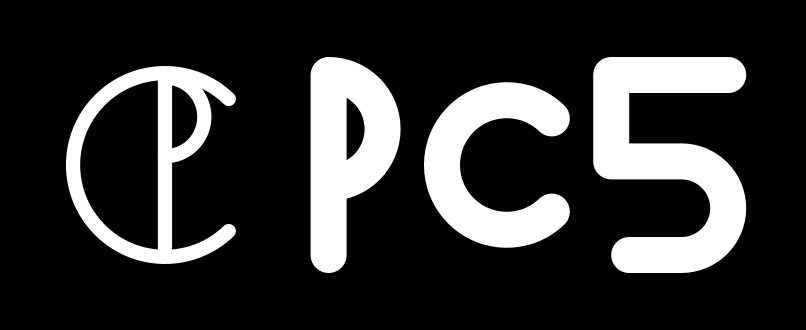
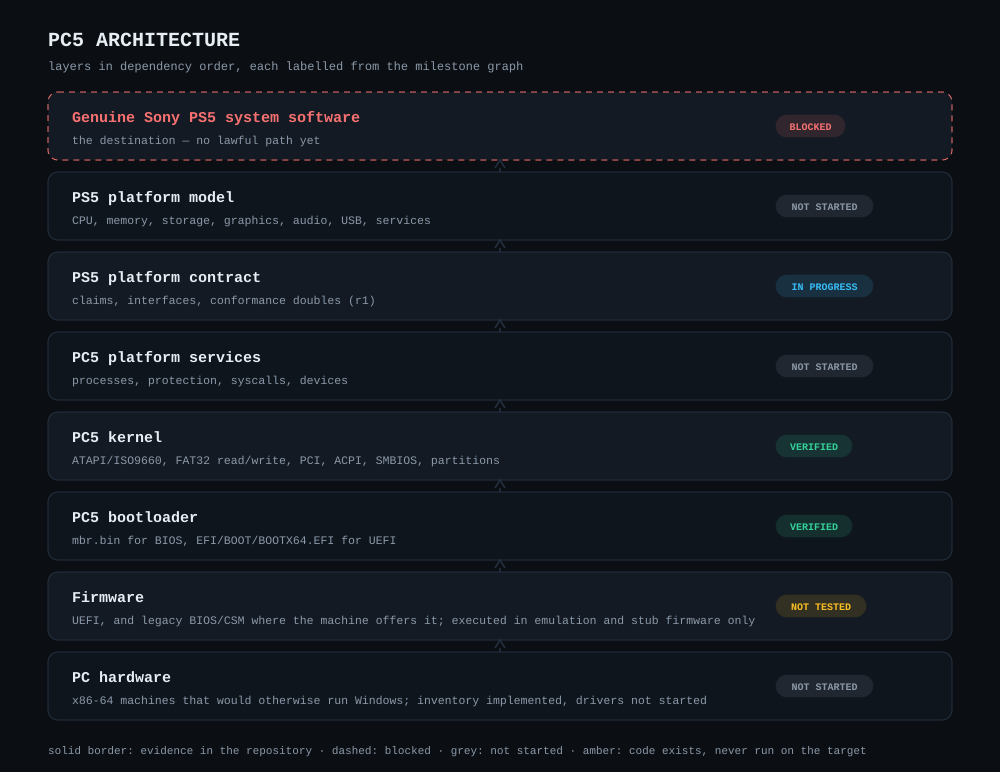
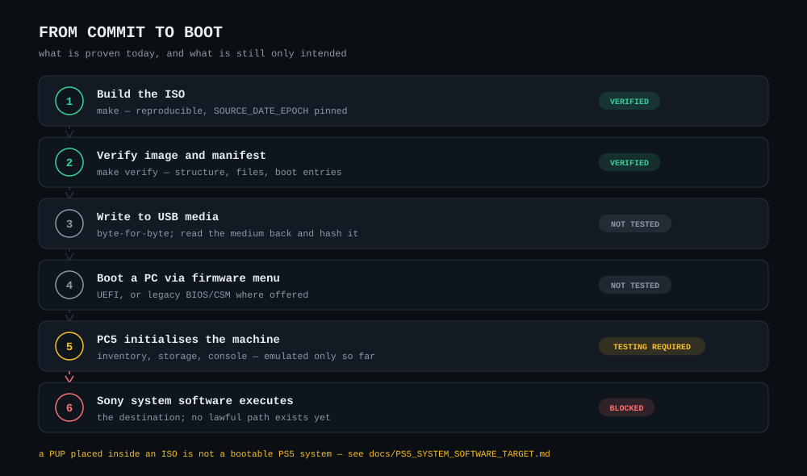
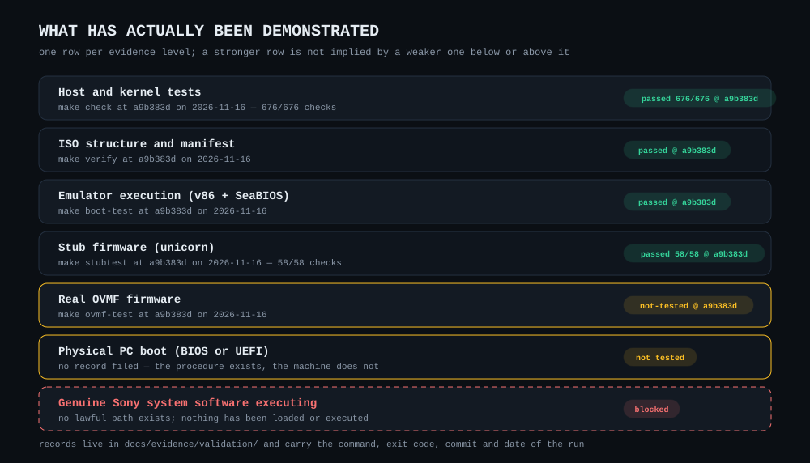
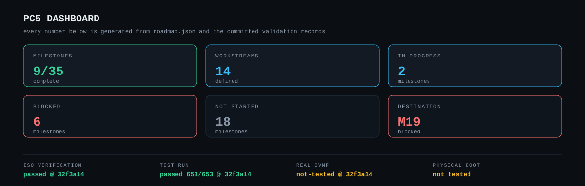

<p align="center">
  
</p>

# About PC5

PC5 is a freestanding operating-system substrate for x86-64 PCs, built for one
destination: to run the genuine Sony PlayStation 5 system software on qualified PC
hardware. It has its own ISO image, its own bootloader, its own kernel, its own
build pipeline and its own evidence discipline. Nothing in the image is Linux, and
nothing in the repository is a Sony payload.

This page is the long-form orientation: what the project is, how it is built, what
actually works today, how "works" is proved here, and where it is going. Every
technical claim below names the file that holds it. Where a claim cannot be
supported, the sentence says so instead of softening.

**Contents** · [Identity](#1-project-identity) ·
[Technical overview](#2-technical-overview) · [Capabilities](#3-what-actually-works) ·
[Engineering standards](#4-engineering-standards) · [Roadmap and progress](#5-roadmap-and-progress) ·
[Licence and attribution](#6-licence-and-attribution) · [Getting involved](#7-getting-involved) ·
[Sources](#8-sources-this-page-was-written-from)

---

## 1. Project identity

<!-- pc5:about-identity:begin -->

> **An independent engineering project that builds PC-side boot, hardware and compatibility infrastructure toward running genuine Sony PlayStation 5 system software on compatible PC hardware.**

PC5 is not a Sony product and contains no Sony software. The identity names the infrastructure this project builds and the destination it is built toward, not an achieved capability: the genuine Sony PS5 system software is the operating system and the user experience, and PC5 is the PC-side boot, hardware and compatibility infrastructure that exists to run it. PC5 does not build a replacement operating system, shell, setup experience or interface to stand in for Sony's, and a PC5 diagnostic or recovery environment is supporting tooling, never the product.

| | |
|---|---|
| **Mission** | PC5 is an independent engineering project whose destination is to run the genuine Sony PlayStation 5 system software on compatible PC hardware, and to deliver the authentic PS5 platform and gaming experience there. |
| **Destination** | `M19` — Genuine system software boots on PC5 (DESTINATION) (level 5) |
| **Destination statement** | Genuine Sony PlayStation 5 system software executing on compatible PC hardware, through PC5's own platform. |
| **Evidence class at the destination** | execution evidence produced by the software itself (levels[4]) |
| **Hardware-enablement substrate** | Linux tier (optional host) — role `hardware-enablement`, `required_for_product: false`, exits at `M8` (ADR-020) |
| **Licence** | **GPL-3.0-only** — the grant in [`LICENSING.md`](../LICENSING.md), the official body in [`LICENSE`](../LICENSE) verified verbatim; no third-party source archive is vendored ([ADR-025](TECHNICAL_DECISIONS.md)) |
| **Roadmap authority** | [PC5_ARCHITECTURE_SPEC_v2.md](architecture/PC5_ARCHITECTURE_SPEC_v2.md), document version `4`, updated 2026-11-28 |

**What the destination cannot be satisfied by** — stated in the roadmap so that no page, figure or release note can quietly substitute one of these for the real thing:

- a PC5 kernel booting
- a simulated or modelled environment running PC5 payloads
- an imitation of the PS5 interface
- an emulator menu PC5 drew
- a screenshot without the software's own output

**Non-goals** — the same list the identity test reads:

- a Linux distribution with a PlayStation theme
- an imitation of the PS5 interface as an end in itself
- distributing, decrypting or keying Sony firmware, or circumventing authentication
- universal hardware support instead of a qualification list
- claiming any success level without the evidence class defined for it

**The success hierarchy, in order** — a level is claimed only with the evidence class named beside it:

- **Level 1 — PC5 boots on qualified PC hardware.**  *Evidence class:* a boot log from physical hardware, committed with the machine identified
- **Level 2 — PC5 controls the required hardware through its own architecture.**  *Evidence class:* boot log plus per-device qualification rows; firmware-provided services do not count
- **Level 3 — Core platform services work.**  *Evidence class:* a test suite that fails when the service is broken, plus a recorded demonstration
- **Level 4 — PS5 execution and system-software interfaces exist and are experimentally validated.**  *Evidence class:* conformance results plus a trace of a PC5-served PS5 contract; a model running PC5's own payload is not level 5
- **Level 5 — Genuine system-software compatibility.**  *Evidence class:* execution evidence produced by the software itself. Never: a PC5 kernel booting, a simulated environment, a PlayStation-style interface, or a screenshot of a menu PC5 drew
- **Level 6 — Platform experience.**  *Evidence class:* per-title records with frame-time measurements, and a runtime log of the genuine system where the level-5 path is the one in use

Every row and bullet above is rendered from `docs/architecture/roadmap.json` and from the licence pair — the grant in `LICENSING.md` over the verbatim `LICENSE` text, read by `tools/licensing.py` — by `tools/presentation.py`.  Nothing in this section is a paraphrase, and nothing in it can be edited without the gate in `tests/test_product_identity.py` noticing.
<!-- pc5:about-identity:end -->

### Why the project exists

The PS5 is a closed platform whose software depends on a machine PC5 cannot
describe, let alone reproduce. The interesting engineering problem is not the
interface and not a lookalike — it is the **substrate**: boot firmware handoff,
exception delivery, memory ownership, interrupt routing, device control and a
platform contract, each of which has to be right before anyone can honestly say a
foreign kernel could run. PC5 exists to build that substrate in the open, on real
PC hardware, and to record exactly how far it has got. The full destination analysis
is in [`docs/playstation/BOOT_FEASIBILITY.md`](playstation/BOOT_FEASIBILITY.md)
and [`docs/PS5_SYSTEM_SOFTWARE_TARGET.md`](PS5_SYSTEM_SOFTWARE_TARGET.md).

### What makes the approach distinctive

| Practice | What it means here | The instrument that enforces it |
|---|---|---|
| Evidence classes, not adjectives | Every success level names the class of artefact that proves it, and a weaker artefact cannot be promoted into it | `product.levels` in [`docs/architecture/roadmap.json`](architecture/roadmap.json); [`docs/TESTING_STRATEGY.md`](TESTING_STRATEGY.md) |
| Claims are data | The identity, the destination, the non-goals and the list of claims the project forbids are fields in the roadmap, and the documents are asserted against them | [`tests/test_product_identity.py`](../tests/test_product_identity.py) |
| The contract has a registry, not a prose file | Every technical statement about the PS5 platform is a `Claim` with sources, a strength and a conformance case; four classifications only, and `UNKNOWN` is a legal value that renders as `UNSUPPORTED` rather than a guess | [`psm/contract.py`](../psm/contract.py), rendered by `make psm-render` |
| Nothing is typed where it can be derived | Status tables, figures and percentages are generated from the graph and the records, so a stale number fails a build | `tools/presentation.py`, `tools/completion.py` |
| One destination, one track | There is no second product and no side experience; the optional Linux host tier is `required_for_product: false` and is not a fallback identity | `WS10`, the `M19` chain, ADR-020 |
| Releasing is a separate, gated act | The release job exists and is tag-gated on the default branch. No tag is an ancestor of `main`, so no release of this history exists; `git tag -l` and `git merge-base --is-ancestor <tag> main` show this in two commands | `.github/workflows/build.yml`, `tools/publish_release.sh` |

---

## 2. Technical overview



The canonical specification is
[`docs/architecture/PC5_ARCHITECTURE_SPEC_v2.md`](architecture/PC5_ARCHITECTURE_SPEC_v2.md);
[`docs/ARCHITECTURE.md`](ARCHITECTURE.md) maps it onto the files in the tree. The
summary below is oriented at the code.

### 2.1 Boot process and firmware interaction



There are three boot paths in the tree, and they are not the same age.

**BIOS, El Torito no-emulation** — the path that has been in the image from the
start. [`boot/mbr.S`](../boot/mbr.S) is the hybrid image's opening sector;
[`boot/loader.S`](../boot/loader.S) runs in real mode and, in this order, brings up
the COM1 serial console so a boot log survives a blank screen, opens the A20 gate,
reads the INT 15h E820 map, loads the video BIOS 8×16 font, negotiates a VBE
linear-framebuffer mode with a text-mode fallback, confirms the ISO9660 primary
volume descriptor, reads the kernel with INT 13h extensions, then enters protected
mode and jumps to the kernel with a boot-info pointer. Every failure has its own
code, reported on serial and on screen.

**UEFI, 32-bit handover** — the loader that ships in the release image
(`PC5_UEFI ?= 32`, documented in [`docs/BUILDING.md`](BUILDING.md)).
[`boot/uefi/bootx64.S`](../boot/uefi/bootx64.S) is the entry stub and the 64→32-bit
trampoline; [`boot/uefi/uefi_main.c`](../boot/uefi/uefi_main.c) uses only the slice
of the specification recorded in [`boot/uefi/efi.h`](../boot/uefi/efi.h), and hands
the same 32-bit kernel a boot-info structure.

**UEFI, 64-bit** — experimental, and labelled as such in its own source.
[`boot/uefi64/uefi64_main.c`](../boot/uefi64/uefi64_main.c) never leaves long mode,
builds PC5-owned 4-level page tables
([`boot/uefi64/pagetables.c`](../boot/uefi64/pagetables.c)), switches `CR3` to them,
publishes a versioned, size-checked handover (`struct pc5_boot64`, protocol version
2, [`boot/uefi64/handover64.h`](../boot/uefi64/handover64.h)), calls
`ExitBootServices` with the memory-map key **and retries when firmware invalidates
that key**, gives the kernel its own stack, and reports on COM1. Placement is
validated against firmware rather than assumed.

One discrepancy is left visible rather than smoothed over. The handover is version 2,
its structure and size defined in
[`kernel64/include/pc5_boot64.h`](../kernel64/include/pc5_boot64.h) and its layout
described in [`docs/ARCHITECTURE.md`](ARCHITECTURE.md#7-the-64-bit-foundation-experimental);
the `F64` deliverable line in `docs/architecture/roadmap.json` still says version 1,
which [`docs/TEST_RESULTS.md`](TEST_RESULTS.md) records as superseded. This page prints
the code's number, and §3 quotes the roadmap's text as it stands, because an About page
is not the place to edit a milestone record — but it is the place to say the two differ.

Firmware interaction is therefore explicit and narrow: firmware is used to load and
describe the machine, and is then left. The kernel calls no firmware service after
the handover, which is what makes "firmware-provided services do not count" a
testable statement rather than a slogan.

### 2.2 Kernel design and responsibilities

Two kernels, both freestanding, both linked as flat images with no loader and no
libc:

[`kernel/`](../kernel) — the 32-bit kernel that boots today.
[`kernel/start.S`](../kernel/start.S) is the 32-bit entry with no paging
(identity-mapped), [`kernel/main.c`](../kernel/main.c) sequences the boot as
*console → timer → inventory → input → compatibility chain → interface*, and logs one
`PC5-LOG` line per stage to serial so a boot can be audited from a log file. Its
modules are small and each owns one interface:

| Module | Responsibility |
|---|---|
| `console.c`, `serial.c`, `ui.c` | framebuffer text console rendered with the firmware font; polled 16550 COM1 at 115200; the boot environment's screen |
| `mem.c`, `part.c`, `block.c`, `ata.c` | the E820 memory map; MBR and GPT discovery read-only; block request rules; ATA/ATAPI PIO |
| `iso9660.c`, `fat32.c`, `storage_test.c` | ISO9660 on top of the block driver; read-only FAT32; the ATA write-path self-test |
| `acpi.c`, `smbios.c`, `cpu.c`, `fw.c` | ACPI root table discovery; SMBIOS structure parsing; CPU identification; the firmware probe |
| `pci.c`, `kbd.c`, `timer.c` | PCI enumeration through configuration mechanism #1; the 8042 PS/2 keyboard; timing |
| `sha256.c`, `lib.c`, `manifest_default.c` | FIPS 180-4 SHA-256; freestanding string, memory and number helpers; the build-replaced firmware manifest record |
| `chain.c`, `kernel.ld` | the PS5 compatibility chain, reported per stage; the link map (flat image at `0x10000`) |

[`kernel64/`](../kernel64) — the 64-bit kernel's entry environment, and the reason
the project has a 64-bit foundation rather than a 64-bit product. It validates the
handover in a deliberate order (address arithmetic on the structure → header →
memory map → everything else, with each remaining pointer range- and
type-checked against the map before it is dereferenced), proves the CPU state,
collects a feature report, and **refuses to print its success marker unless every
mandatory check passed** — a marker that appears anyway would be worse than no
marker. Its subsystems are
[`idt64.S`](../kernel64/idt64.S)/[`idt64.c`](../kernel64/idt64.c) (one trampoline
per exception vector, `0..31`),
[`tss64.c`](../kernel64/tss64.c) (task-state segment and interrupt stacks),
[`apic64.c`](../kernel64/apic64.c) (local APIC bring-up "in the only order that
works"), [`madt64.c`](../kernel64/madt64.c) (CPU enumeration from ACPI's MADT),
[`mem64.c`](../kernel64/mem64.c) (frame allocation over the handover map),
[`timer64.c`](../kernel64/timer64.c) (a PIT-calibrated TSC) and
[`kimage64_head.c`](../kernel64/kimage64_head.c) — a fixed-size header at the start of
`KERNEL64.BIN`: the image describing itself, validated by the loader
against [`boot/uefi64/kimage64.c`](../boot/uefi64/kimage64.c).

[`psm/`](../psm) — the **P**C5 **P**latform **S**ervice **M**odel: PC5-authored test
doubles for the subsystems the PS5 platform contract names (`PSM-CPU`, `PSM-MEM`,
`PSM-IRQ`/`PSM-TMR`/`PSM-IPC`, `PSM-STOR`, `PSM-GFX`, `PSM-AUD`, `PSM-USB`,
`PSM-SVC`), each at `v0`, each with a conformance suite. The package says what it is
for in its own words: it is not a Sony interface, not a Sony ABI, and not evidence
that Sony's system software would accept any of it. Its registry is what
[`docs/architecture/PS5_PLATFORM_CONTRACT.md`](architecture/PS5_PLATFORM_CONTRACT.md)
is rendered from, so the document and the code cannot disagree.

### 2.3 Build and image-generation pipeline

Everything is driven by the [`Makefile`](../Makefile) and by PC5-authored Python in
[`tools/`](../tools); there is no configure step, no package manager for the image
contents, and no network fetch inside the build.

| Stage | Command | What it produces, and who checks it |
|---|---|---|
| Compile | `make iso` | `gcc -m32 -ffreestanding -fno-pic -fno-stack-protector -fno-builtin` objects, linked by `ld -m elf_i386 -T kernel/kernel.ld --oformat binary -nostdlib` |
| Assemble the image | `make iso` | [`tools/mkiso.py`](../tools/mkiso.py) lays out the hybrid ISO9660 image with the El Torito boot catalog and the ESP, allocating every extent by a fixed rule and stamping the volume from `SOURCE_DATE_EPOCH` rather than the wall clock |
| Describe the image | `make manifest` | [`tools/iso_manifest.py`](../tools/iso_manifest.py) — per-file SHA-256 values and the image digest |
| Verify the image | `make verify` | [`tools/verify_iso.py`](../tools/verify_iso.py) checks structure and checksums against the manifest; this is the gate `M1*` evidence is filed against |
| Inspect | `make info`, `pc5ctl info`, `pc5ctl verify` | [`tools/pc5ctl.py`](../tools/pc5ctl.py) is the single command line for the repository |
| 64-bit image | `make iso64` | the long-mode loader and `KERNEL64.BIN`, with `ISO_ESP_EXTRA` placing the 64-bit kernel on the ESP |
| UEFI stubs | `make uefi64`, `make stubtest64` | the loader executed against PC5's own stub firmware, so loader behaviour is testable without a machine |

The image is `build/pc5.iso`; `build/` is generated, ignored and never cited as
evidence by the documentation until a record is filed.

### 2.4 Testing, verification and CI



The suite is host-side Python (`unittest`, no framework to install beyond
[`requirements-harness.txt`](../requirements-harness.txt),
which the harness target provisions), and it tests the *image* as
well as the tools: the ELF and PE checks, the manifest cross-check, the link-map
assertions, the firmware contract, the corpus of genuine boots. See
[`docs/TESTING_STRATEGY.md`](TESTING_STRATEGY.md) for the sixteen evidence levels and
what each command can and cannot prove; [`docs/GATES.md`](GATES.md) is the gate
inventory.

[`build.yml`](../.github/workflows/build.yml) runs three jobs:

| Job | Ceiling | What it does |
|---|---|---|
| `build` | 30 min | builds the image, verifies structure and checksums, runs the unit and host suites, the architecture/roadmap gate, the platform-contract and brand gates, the documentation and evidence gates, executes the UEFI loader against the stub firmware, boots the image in the emulator, proves the build is reproducible, and stages the release assets |
| `ovmf` | 40 min | provisions QEMU and TianoCore OVMF, builds the image, boots it under genuine firmware including the Secure Boot policy check, and keeps the firmware report, serial logs and the matrix |
| `release` | 15 min | `if: startsWith(github.ref, 'refs/tags/')` — fetches the verified assets, checks them before publishing, then creates or updates the release; it is the only job with write access to contents |

`docs/evidence/validation/*.json` holds one record per gate, written by
[`tools/validation.py`](../tools/validation.py) with the commit it ran on; the
figures and both generated pages read those records rather than any badge. That is
why the dashboard can say *verified 2026-11-23 at `86b862f`* instead of *CI is
green*: a pipeline is not a proof, and a badge is not a record.

### 2.5 Reproducibility and release engineering

Two inputs are embedded in the kernel and therefore in the image digest: the build id
(`BUILD_ID`, default `git rev-parse --short HEAD` with `-dirty` appended when tracked
files differ) and the build timestamp (`STAMP_EPOCH`, from `SOURCE_DATE_EPOCH`). Byte
identical output therefore needs the same commit *and* the same timestamp — that is
the documented contract, and
[`tests/test_tools.py`](../tests/test_tools.py) asserts
`test_source_date_epoch_makes_builds_byte_identical`. [`tools/buildmeta.py`](../tools/buildmeta.py)
appends a `build` object to the image record describing how the image was produced and
what was verified, without touching the image. Read
[`docs/BUILDING.md`](BUILDING.md#reproducibility) for the recipe and
[`docs/UPDATE_SYSTEM.md`](UPDATE_SYSTEM.md) for how an image is updated.

Release engineering is deliberately separated from building:
[`tools/publish_release.sh`](../tools/publish_release.sh) requires three assets,
checks them, verifies each checksum, prints a `PASS` verdict, and asserts at the end
that every asset landed. On `main`, the `release` job is skipped on every non-tag run
and has executed **0 steps** — so *the repository has published nothing*, and this
page says it in those words rather than leaving a reader to infer it.

### 2.6 Languages and technologies

| Layer | Technology, as recorded in the build |
|---|---|
| Boot stages | x86 assembly for the real-mode and handover stubs, assembled with GNU `as`; C for both UEFI loaders |
| Kernels | C, `-ffreestanding`, `-fno-pic -fno-stack-protector -fno-builtin`, `-m32` for the boot kernel and `-m64` with `-Werror` for the 64-bit path; linked with `-nostdlib` against PC5 link maps; no libc, no OS runtime |
| Image | written by PC5's own Python tooling; the layout rules are code, not a shell script's incidental ordering |
| Harness and tests | Python 3, `unittest`; the emulator and firmware harness is provisioned by the Makefile and `tools/ovmf_setup.sh` |
| Toolchain in CI | `gcc`, `ld`, `make`, QEMU, TianoCore OVMF on `ubuntu-24.04` |

---

## 3. What actually works



The distinction the project insists on is between *standing* and *claim*. Five
standings are used, all of them read from the roadmap rather than judged here.

<!-- pc5:about-capabilities:begin -->
| Standing | Count | How this bucket is decided |
|---|---:|---|
| **Implemented and verified** | 10 | the milestone's state is `complete`, which in this roadmap means its acceptance criteria are met and evidence is filed in the repository |
| **Implemented, not fully validated** | 2 | an entry in `roadmap.json`'s `foundations[]`, whose recorded `state` says what has been tested and what has not |
| **Experimental or in progress** | 9 | state `in_progress`; these earn nothing in the completion figure |
| **Planned** | 18 | state `not_started` |
| **Blocked** | 6 | state `blocked`, with the blocker named in the roadmap |

**Implemented and verified** — with the file that holds the evidence, so the claim can be checked rather than trusted:

- `M0` — Architecture realignment: one platform, one destination (6 acceptance criteria · evidence: [`docs/architecture/ARCHITECTURE_DISCREPANCY_REPORT.md`](architecture/ARCHITECTURE_DISCREPANCY_REPORT.md), [`docs/architecture/PC5_ARCHITECTURE_SPEC_v2.md`](architecture/PC5_ARCHITECTURE_SPEC_v2.md), [`docs/architecture/roadmap.json`](architecture/roadmap.json), [`docs/TECHNICAL_DECISIONS.md`](TECHNICAL_DECISIONS.md))
- `M1a` — Reproducible BIOS boot medium (2 acceptance criteria · evidence: [`docs/TEST_RESULTS.md`](TEST_RESULTS.md), [`tools/verify_iso.py`](../tools/verify_iso.py))
- `M1c` — UEFI boot path under real firmware (10 acceptance criteria · evidence: [`docs/TEST_RESULTS.md`](TEST_RESULTS.md), [`tests/ovmf_boot.py`](../tests/ovmf_boot.py), [`tests/uefi_stubtest.py`](../tests/uefi_stubtest.py), [`boot/uefi/README.md`](../boot/uefi/README.md), [`docs/evidence/2026-11-23-64bit-boot-gate/README.md`](evidence/2026-11-23-64bit-boot-gate/README.md), [`docs/evidence/2026-11-23-64bit-genuine-ovmf-boot/README.md`](evidence/2026-11-23-64bit-genuine-ovmf-boot/README.md), [`docs/evidence/2026-11-24-kernel-image-header/README.md`](evidence/2026-11-24-kernel-image-header/README.md), [`docs/engineering/KERNEL-IMAGE64-HEADER-DESIGN-v1.md`](engineering/KERNEL-IMAGE64-HEADER-DESIGN-v1.md), [`tests/test_kimage64.py`](../tests/test_kimage64.py))
- `M1d` — ATA PIO write path with verified read-back (2 acceptance criteria · evidence: [`docs/TEST_RESULTS.md`](TEST_RESULTS.md), [`kernel/ata.c`](../kernel/ata.c))
- `M1e` — MBR and GPT partition discovery (read-only) (2 acceptance criteria · evidence: [`docs/TEST_RESULTS.md`](TEST_RESULTS.md))
- `M1f` — Read-only FAT32 filesystem (2 acceptance criteria · evidence: [`docs/TEST_RESULTS.md`](TEST_RESULTS.md))
- `M1g` — FAT32 create with independent read-back (2 acceptance criteria · evidence: [`docs/TEST_RESULTS.md`](TEST_RESULTS.md))
- `M1h` — Hybrid MBR: the same image boots as a hard disk (2 acceptance criteria · evidence: [`docs/TEST_RESULTS.md`](TEST_RESULTS.md))
- `M1i` — FAT32 overwrite, directories and 8.3 paths (3 acceptance criteria · evidence: [`docs/TEST_RESULTS.md`](TEST_RESULTS.md))
- `M22` — Transformation baseline: what exists, what it proves, and what is owed (6 acceptance criteria · evidence: [`docs/TRANSFORMATION_BASELINE.md`](TRANSFORMATION_BASELINE.md), [`docs/research/PS5_FIRMWARE_AND_PUP.md`](research/PS5_FIRMWARE_AND_PUP.md), [`docs/architecture/EXECUTION_FEASIBILITY.md`](architecture/EXECUTION_FEASIBILITY.md), [`docs/architecture/ARCHITECTURE_DECISION_RECORD.md`](architecture/ARCHITECTURE_DECISION_RECORD.md))

**Implemented, not fully validated** — quoted from `foundations[]`, because the distinction *is* the sentence:

- **`F64`** — Experimental 64-bit long-mode boot path  
  *Standing:* host-tested and stub-firmware-tested; not verified on genuine UEFI firmware or physical hardware  
  *Reaches milestone* `M2a`, and does not complete it.
  - Delivers: boot/uefi64: a UEFI application that stays in long mode and hands over in it
  - Delivers: a PC5-owned identity map (1 PML4 + 1 PDPT + 4 PD, 2 MiB pages, below 4 GiB)
  - Delivers: struct pc5_boot64, protocol version 1, with magic, size and per-field validation
  - Delivers: ExitBootServices with the memory-map key and a bounded retry loop
  - Delivers: kernel64: a freestanding kernel that proves long mode, paging, its CR3 root, its stack and its boot info before printing PC5-64BIT-LONG-MODE-OK
  - Not completed: M2a still requires interrupt delivery, a second CPU brought up, and per-machine SVM records
  - Not completed: APIC bring-up, exception capture, a PIT-calibrated TSC and MADT CPU enumeration exist (7737d89, 094a03e, 43ab4af, 547ebd5), but nothing takes an interrupt
  - Not completed: no OVMF run and no physical machine has executed this path
  - Not completed: no interrupts, no SMP, no process separation, no SVM initialisation
  - Not completed: the installed IDT is never exercised by a device: a fault reaches it, an external interrupt does not
  - Not completed: the task-state segment and its interrupt stacks are built and their table is installed, but TR is not loaded, so IST stays unarmed - measured under the emulator, where executing LTR itself raises an exception
- **`F64M`** — Memory-management groundwork for the 64-bit kernel  
  *Standing:* partial: page tables, ownership rules, and a physical frame pool whose first consumer is the task-state segment and its interrupt stacks  
  *Reaches milestone* `M2b`, and does not complete it.
  - Delivers: boot/uefi64/pagetables.c: identity-map construction, uncached marking, lookup
  - Delivers: ownership rules: the loader owns buffers until handover, the kernel owns tables, stack and image
  - Delivers: boot-info pointers constrained below 4 GiB and validated before use
  - Not completed: the pool's only consumers are the task-state segment and the two interrupt stacks it holds; there is no general-purpose heap, no page-level protection, no per-process address space and no DMA protocol
  - Not completed: no frame is ever handed back: the TSS holds three for the life of the boot, and nothing else has taken or released one during an executed run
  - Not completed: the kernel does not yet map above 4 GiB, use NX, or provide guard pages

**Experimental or in progress** — where work is open right now:

- `M2a` — CPU execution environment: long mode, APIC, SMP and timers  
  *Advances:* level 2 and the execution environment the platform model needs: the CPU contract is the PS5 contract's first row
- `M2b` — Memory management: paging, protection and DMA-visible memory  
  *Advances:* level 2 and the host side of the unified-memory model: the destination's memory contract sits here
- `M9` — System-software baseline and provenance record  
  *Advances:* establishes what the protected input actually is before anything is built around it
- `M10` — PS5 platform contract specification  
  *Advances:* the destination needs a written platform contract before a single device model can be built
- `M23` — The first runnable PC5.exe: window, navigation, services, settings, log, tests  
  *Advances:* the product surface: a real Windows application that owns state, persists settings and can be started, inspected and stopped
- `M24` — Subsystems behind contracts: execution, diagnostics, firmware integrity, storage state  
  *Advances:* the boundary that keeps a future guest engine, a host probe and a package reader from becoming three dialects of one lie
- `M25` — Genuine-execution interface research: lawful inputs, observable contracts, no decryption  
  *Advances:* keeps the destination reachable as a research programme while the product is built, without pretending the blockers are smaller than they are
- `M27` — Update and installation semantics against PC5's own package format  
  *Advances:* the package, verification and rollback behaviour a real system needs, implemented where PC5 owns the format
- `M28` — Four evidence dimensions in CI, with the application dimension on Windows  
  *Advances:* the reporting shape the owner asked for: application, legacy image, research and release readiness each carry their own colour, so a green ISO cannot imply a working app

**Planned** — 18 milestones carry `not_started`; the list is in [docs/ROADMAP.md](ROADMAP.md) and in `docs/architecture/roadmap.json`, and none of them is described as done anywhere in this repository.

**Blocked** — 6 milestones, each with its blocker quoted: see the generated table in [README → What is blocked](../README.md#what-is-blocked).  This page does not repeat it, because two copies of a blocker list are two things that can go stale.

Generated by `tools/presentation.py` from `docs/architecture/roadmap.json`; the counts are the same `distribution()` the README prints, so the two pages cannot disagree about how much of PC5 exists.
<!-- pc5:about-capabilities:end -->

The three words in that table are the same three the README uses, with the same
definitions, because a page that invents its own vocabulary can soften a standing without
changing a number: **VERIFIED** means the evidence is in this repository at the level the
rung names, **NOT TESTED** means the code may exist but has never run on the hardware it
targets, and **BLOCKED** means a named dependency cannot be satisfied here rather than
that work was abandoned.

Two rules follow from this and are worth stating plainly. An emulator pass is not a
firmware boot, and a firmware boot is not a physical boot — see
[`docs/TESTING_STRATEGY.md`](TESTING_STRATEGY.md#1-sixteen-evidence-levels). And no
rung of the ladder has been reached on the destination: genuine Sony system software
has never been loaded here, the package in the repository root is a Git LFS pointer
whose payload is absent, and [`docs/KNOWN_LIMITATIONS.md`](KNOWN_LIMITATIONS.md)
lists what that leaves unsolved.

---

## 4. Engineering standards

| Standard | How it is practised | Where it is enforced |
|---|---|---|
| **Deterministic builds** | `SOURCE_DATE_EPOCH` pins volume and directory records; `mkiso.py` allocates extents by a fixed rule and writes a constant disk signature, so output does not depend on file-system order or on when you build | `make iso` twice inside the `build` job's "Prove the build is reproducible" step; the test named in §2.5 |
| **Automated verification** | the image is verified structurally and by checksum, not by inspection; every gate writes a record naming its own commit | `make verify`, `tools/verify_iso.py`, `tools/validation.py`, `docs/evidence/validation/` |
| **Firmware and boot testing** | three depths, kept apart: PC5's stub firmware (fast, deterministic), genuine TianoCore OVMF in QEMU, and physical hardware — with the physical rung currently unrecorded and said to be unrecorded | `make stubtest`, `make stubtest64`, `make ovmf-test`, `make boot-test`, [`docs/HARDWARE_COMPATIBILITY.md`](HARDWARE_COMPATIBILITY.md) |
| **Evidence-backed milestones** | `complete` requires met acceptance criteria *and* a filed evidence path; the generator refuses a `complete` milestone with no evidence, and refuses to invent a fraction for an in-progress one | [`tools/roadmap.py`](../tools/roadmap.py), [`tools/completion.py`](../tools/completion.py), `make roadmap` |
| **Security and reliability** | the project's rules are prohibitions with teeth: no key extraction, no signature or Secure Boot bypass, no firmware decryption, no redistribution of anything Sony's; refusals are recorded as blockers rather than worked around | [`docs/SECURITY.md`](SECURITY.md), ADR-022, the non-negotiable rules in [`CONTRIBUTING.md`](../CONTRIBUTING.md) |
| **Documentation and reproducibility** | documentation is generated where it is numeric and linked where it is narrative; `make docs-check` fails a broken link, a renamed anchor, a `make` command with no target, and a cited path that does not exist | [`tools/docs_check.py`](../tools/docs_check.py), [`docs/PRESENTATION.md`](PRESENTATION.md) |
| **Transparent release readiness** | readiness and publication are two different fields on every page; a ready-but-unpublished state is printed as such, and the figures freeze on their true values so nothing decorative can overstate | `tools/completion.py`, `tools/presentation.py`, `make presentation-check` |

The rules a contributor has to keep are in
[`CONTRIBUTING.md`](../CONTRIBUTING.md#non-negotiable-rules). The short version is
that a new claim needs a test that would fail if the claim were false, and evidence is
never weakened to keep a gate green.

---

## 5. Roadmap and progress


<!-- pc5:about-progress:begin -->
| | |
|---|---|
| **Overall completion** | **23.4%** — earned acceptance-criteria weight ÷ declared weight |
| **Milestones** | 10 complete · 9 in progress · 6 blocked · 18 not started, in 15 workstreams |
| **Current milestone** | `M2a`, `M2b`, `M9`, `M10`, `M23`, `M24`, `M25`, `M27`, `M28` |
| **Last verified** | 2026-11-23 — `verify` recorded **passed** at `86b862f` (10/11 committed gate records passed) |
| **Hosted CI** | run `46102447128` **SUCCESS** at `a79df48`, 1382 host tests OK (13 skipped) |
| **Release** | `M1b` **BLOCKED** — nothing published |
| **Canonical roadmap** | [docs/ROADMAP.md](ROADMAP.md) · [`roadmap.json`](architecture/roadmap.json) |

The figure is criteria-weighted, not commit-weighted: 37 of 158 declared acceptance criteria are met.  Counting milestones instead gives 23.3%, and the two agree within 0.2 points — so the headline is not an artefact of the weighting.  Progress is **never** computed from commits, files, lines or test counts, and an `in_progress` milestone scores zero until it declares which of its criteria it has met.  `python3 tools/completion.py model` reprints this calculation; `python3 tools/completion.py check` refuses inconsistent roadmap data.
<!-- pc5:about-progress:end -->

**The canonical documents** are [`docs/ROADMAP.md`](ROADMAP.md) (the narrative,
including the destination workstream and the dependency path),
[`docs/architecture/PC5_MILESTONE_GRAPH.md`](architecture/PC5_MILESTONE_GRAPH.md)
(the graph), and [`docs/architecture/roadmap.json`](architecture/roadmap.json) (the
data both are generated and checked from). `make roadmap` validates the data;
`python3 tools/roadmap.py path` prints the chain a milestone depends on.

**Publication, stated precisely, because a short version of this sentence is easy to
misread.** `M1b` is `blocked`, and no artefact of this history has ever been published:
`pc5.iso`, `pc5.iso.sha256` and `build-info.json` are the three things its acceptance
names, and the release job is gated on a tag on the default branch. Separately from that,
the repository's *other* refs do contain a tag named `pc5-0.1.0`, whose GitHub release
carries no assets and whose target commit is **not** an ancestor of `main` — it predates
the current history rather than describing it. Check it yourself with `git tag -l` and
`git merge-base --is-ancestor pc5-0.1.0 main`; the answer this page gives is about the
history in front of the reader, and it does not claim the tag does not exist.

**How to read a state.** `complete` means the acceptance criteria are met and
evidence is filed — not that a feature exists. `in_progress` means work is open and
it earns nothing in the figure. `blocked` means an obstacle is recorded with its
cause named. `not_started` means exactly that.

**How progress is measured, and what it is never measured by.** The percentage is
earned acceptance-criteria weight divided by declared weight, computed by
[`tools/completion.py`](../tools/completion.py) from the roadmap and the committed
verification records. It is never derived from commit counts, file counts, lines of
code or test counts, because all four of those rise while a project is failing. Every
figure and percentage on this page and in the README comes from that one model, so
the two pages cannot disagree — and a number typed into prose instead of generated
fails `make presentation-check`, which `make check` runs.

**Keeping this page current.** `.github/workflows/progress.yml` regenerates the
figures and every generated block — on both pages — after `build` completes
successfully on `main`, files that run as evidence, and commits only when something
actually moved. A failed, cancelled or unfinished verification cannot publish an
update, so what you read here describes the last verified state, not the last hope.

---

## 6. Licence and attribution

PC5's licence is stated by two files, and the difference between them is the point:

* [`LICENSING.md`](../LICENSING.md) is **this project speaking in its own person** — the
  notice that grants a licence, records why that version, and lists what is not PC5's to
  grant. It is short on purpose; it is not a copy of anything.
* [`LICENSE`](../LICENSE) is **the official text, verbatim** — the 674-line standard document
  with no project-specific wording anywhere in it. Its size is not quoted here on purpose: a
  figure typed into prose is a figure that goes stale, so what the check does is re-hash the
  bytes against the digest pinned in [`tools/licensing.py`](../tools/licensing.py) and name
  both digests when they differ.

The licence row in §1 is generated on every run: [`tools/licensing.py`](../tools/licensing.py)
reads the grant sentence out of the notice and then verifies the official body against the
SHA-256 it pins, printing `python3 tools/licensing.py` as a one-line answer. This section
deliberately does not restate the identifier in prose. A licence id typed into a paragraph is
a second copy of a fact that has one source, and the second copy is the one that goes stale.

What the reader refuses is part of the design, because each refusal is a way a documentation
change could otherwise invent a licence:

- **a notice that states no grant.** A file may *describe* a licence without granting one. The
  verbatim FSF text is the extreme case: its *How to Apply These Terms to Your New Programs*
  section hands every project the same sentence — "either version 3 of the License, or (at your
  option) any later version" — as a template for applying the licence, and the document never
  mentions PC5 at all. Deriving an id from either would print a guess in somebody else's
  wording, and then blame every document that disagreed with the guess.
- **a GPL grant with no version, or with no statement about later versions.** "Only" and "any
  later version" are different obligations; silence is not defaulted to either, and this tool
  will not widen a grant on a project's behalf.
- **a notice that contradicts itself.** An asserted identifier beside a grant sentence that
  implies another one means no controlled document can be checked against either reading, so
  the contradiction is reported instead of resolved by preference.
- **an edited official text.** An inserted paragraph, a reworded clause or a stray space makes
  the file not-the-GPL even when it still opens like it. The refusal says "it has been edited",
  names the two digests, and points at the notice as where project-specific wording belongs.
- **an official text that is a different licence's document.** When the file is the version-2
  body and the notice grants version 3, that is a contradiction between the standard document
  and this project's decision; no page picks a side, and the gate fails until one of the two
  moves.

A refusal is printed, not thrown. Aborting would take every figure and every other generated
block down with the one ambiguous file — several false failures wrapped around one true
statement, and the page would lose the chance to say that statement at all. Instead the row in
§1 says that no identifier can be printed and names the file at fault, and `make docs-check`
reports the same problem once, against that file. `make docs-check` also compares every licence
identifier in the documents that describe the project — the README, this page,
[`CONTRIBUTING.md`](../CONTRIBUTING.md) and [`docs/BRAND.md`](BRAND.md) — against the same
reading, so a change to the grant becomes a red gate naming a file rather than a permanent
inconsistency across four pages. Because the row is derived from the tree it is written into,
changing either licence file means regenerating the page (`make presentation`, then
`make presentation-check`); a merge that resolves `LICENSE` by hand and does not regenerate is
caught rather than shipped.

The reasoning behind the choice is [ADR-027](TECHNICAL_DECISIONS.md), which records the
alternative that was on the table — a short `LICENSE` holding a preamble, a pointer and a
grant of the second version, against a `main` whose 674-line text grants nothing to PC5 in its
own words — and why neither file was kept as it stood. GitHub's licence field is *detected* by
scanning the opening of the text, so a badge can disagree with a grant; nothing here consults
the badge, and this repository has no package manifest of its own to carry a `License:` field — the
metadata *is* the two files above plus the README's summary table, all of them checked against
one reading.

- **No third-party code is vendored.** No archive, no subtree, no imported asset. The
  repository began with a third-party source archive at its root; it was removed, and its
  former presence is recorded in
  [`docs/TECHNICAL_DECISIONS.md`](TECHNICAL_DECISIONS.md) as ADR-025 and measured in
  [`docs/PROJECT_AUDIT.md`](PROJECT_AUDIT.md). PC5 is not a fork, companion or affiliate of any
  other project, and the project's name does not appear in PC5's documents —
  [`tests/test_project_independence.py`](../tests/test_project_independence.py) enforces that.
  A scan of the tracked sources for a header declaring a third-party origin finds none, which is
  *why* there are no third-party notices to preserve here rather than a claim that there never
  could be.
- **The rule is a build rule, so it does not depend on the notice.** `gcc`, GNU binutils, QEMU
  and TianoCore OVMF are consumed to build and to test — the CI harness provisions the firmware
  at run time — and none of them is incorporated into `build/pc5.iso`, so none of their terms
  reach the image. Results produced against OVMF are described as emulator results
  ([`docs/TEST_RESULTS.md`](TEST_RESULTS.md),
  [`docs/HARDWARE_COMPATIBILITY.md`](HARDWARE_COMPATIBILITY.md)) and never as physical-hardware
  validation.
- **GPL compliance is designed in, not asserted.** A distributed image embeds the manifest its
  own build produced, and the build recipe, the kernel sources and the loader are the
  corresponding source: they are the tree. See
  [`docs/architecture/LINUX_VS_FREESTANDING.md`](architecture/LINUX_VS_FREESTANDING.md) for the
  reasoning that made a freestanding kernel the compatible choice.
- **One question is left open, on purpose.** No file in the tree carries a copyright line, and
  the repository has no contributor agreement, so the set of licensors whose permission a
  future relicensing would need is not recorded anywhere. Naming a holder or adding per-file
  `SPDX-License-Identifier` comments would make that unknown look resolved, and a header comment
  is a copyright assertion about somebody's work. [`LICENSING.md`](../LICENSING.md) lists what
  would have to be true first — including re-baselining every reproducibility digest that hashes
  a source file, since a header changes bytes and therefore changes hashes.
- **Attribution and identity.** Contributions keep the licence, and a change that imports code
  has to record its provenance in the pull request; ADR-025 is what a reviewer reads before
  accepting one.

---

## 7. Getting involved

**Build it.** These are the commands the repository actually provides. Every one names
a real target in the [`Makefile`](../Makefile), and that is checked rather than
promised: `make docs-check`, which `make check` runs, fails any document that
documents a `make` command with no target behind it.

```sh
git clone https://github.com/SpicyBadran/PC5.git && cd PC5
make iso          # build the hybrid BIOS/UEFI image into build/pc5.iso
make verify       # structural verification and the manifest cross-check
make unit         # kernel unit tests, on the host
make check        # the authoritative gate: host suite, then every documented gate
make docs-check   # links, anchors, documented commands and cited paths
make roadmap      # validate the milestone graph against its own rules
make presentation # regenerate the figures and both generated pages
```

**Boot it, if you have the harness.** `make boot-test` runs the image in an emulator
and `make ovmf-test` runs it against genuine TianoCore OVMF (provisioned by
`make ovmf-setup`). Both are artifact-gated: on a machine without the emulator or the
firmware they exit with code 77 and say so, and the host suite skips them with the
reason recorded. That is why this page asserts no physical-boot result.

**Write to a stick, then read what it says.** `pc5ctl usb --device /dev/sdX --iso
build/pc5.iso` refuses an unconfirmed device, refuses the device holding the running
root filesystem, and re-verifies the image checksum first. `pc5ctl boot`,
`pc5ctl chain --log FILE` and `pc5ctl fw analyze --input IMAGE` cover booting, the
compatibility chain from a serial log, and firmware analysis (no decryption).

**Where to start reading.** [`docs/INSTALLATION.md`](INSTALLATION.md) for running the
image, [`docs/BUILDING.md`](BUILDING.md) for the toolchain and targets,
[`docs/ARCHITECTURE.md`](ARCHITECTURE.md) for the file-level map,
[`docs/ROADMAP.md`](ROADMAP.md) for where the work is going, and the
"which document is authoritative for what" table in
[`CONTRIBUTING.md`](../CONTRIBUTING.md#which-document-is-authoritative-for-what)
before you disagree with any of them.

**How to contribute.** [`CONTRIBUTING.md`](../CONTRIBUTING.md) is the contract: the
non-negotiable rules, the loop a change goes through, and what a PR has to carry.
Use the templates in [`.github/ISSUE_TEMPLATE`](../.github/ISSUE_TEMPLATE) —
`bug_report.yml` and `feature_request.yml` — and read
[`docs/SECURITY.md`](SECURITY.md) before reporting anything security-shaped. Issues
and pull requests are the venue; this repository runs no discussion forum.
[`docs/TECHNICAL_DECISIONS.md`](TECHNICAL_DECISIONS.md) is where a decision gets
recorded so that a re-litigation has something to argue with.

---

## 8. Sources this page was written from

| Source | What it established |
|---|---|
| [`docs/architecture/roadmap.json`](architecture/roadmap.json) | identity, mission, destination, non-goals, levels, foundations, workstreams, every milestone state and acceptance list quoted above |
| [`docs/ARCHITECTURE.md`](ARCHITECTURE.md), [`docs/architecture/PC5_ARCHITECTURE_SPEC_v2.md`](architecture/PC5_ARCHITECTURE_SPEC_v2.md) | the layer model and the boot chain as implemented |
| [`docs/TESTING_STRATEGY.md`](TESTING_STRATEGY.md), [`docs/GATES.md`](GATES.md) | the evidence levels, and what each gate can and cannot prove |
| [`docs/BUILDING.md`](BUILDING.md), [`docs/INSTALLATION.md`](INSTALLATION.md) | targets, `PC5_UEFI`, the reproducibility contract, running the image |
| [`docs/KNOWN_LIMITATIONS.md`](KNOWN_LIMITATIONS.md), [`docs/HARDWARE_COMPATIBILITY.md`](HARDWARE_COMPATIBILITY.md) | what is unsolved, and the finite qualification list |
| [`docs/TECHNICAL_DECISIONS.md`](TECHNICAL_DECISIONS.md) | ADR-020 (the substrate is optional), ADR-022 (nothing Sony's is handled), ADR-025 (no vendored archive, no borrowed identity) |
| [`docs/PS5_SYSTEM_SOFTWARE_TARGET.md`](PS5_SYSTEM_SOFTWARE_TARGET.md), [`docs/playstation/BOOT_FEASIBILITY.md`](playstation/BOOT_FEASIBILITY.md) | what running the system software would require, and the lawful boundary |
| [`docs/BRAND.md`](BRAND.md) | the mark, the palette and the type this page's figures are drawn with |
| [`docs/PRESENTATION.md`](PRESENTATION.md) | how the figures and generated blocks are produced and checked |
| [`docs/evidence/validation/`](evidence/validation/), [`docs/evidence/ci/`](evidence/ci/) | every "verified", "passed" and "recorded" statement, with its date and commit |
| [`Makefile`](../Makefile), [`tools/`](../tools), [`boot/`](../boot), [`kernel/`](../kernel), [`kernel64/`](../kernel64), [`psm/`](../psm) | the flags, targets, module responsibilities and refusals quoted verbatim in §2 |
| [`.github/workflows/build.yml`](../.github/workflows/build.yml), [`.github/workflows/progress.yml`](../.github/workflows/progress.yml) | the job ceilings, steps, permissions and the maintenance path |

## 9. What this page will not say

No performance figure, because none is measured here. No hardware compatibility list
beyond the qualification document. No percentage of PS5 compatibility, because the
software has not been executed. No "works on your machine" implication: the emulator
and stub-firmware results are exactly as far as the evidence goes, and the physical
rung has no record. No claim that anything from this history has been released —
the release position §5 states is the whole of it.

This page is documentation, so it changes without a merge to `main` being a
release. If it ever contradicts [`README.md`](../README.md), the roadmap gate, or a
record under `docs/evidence/`, **the record wins** — and `make check` is the arbiter
of whether that contradiction is allowed to exist.
